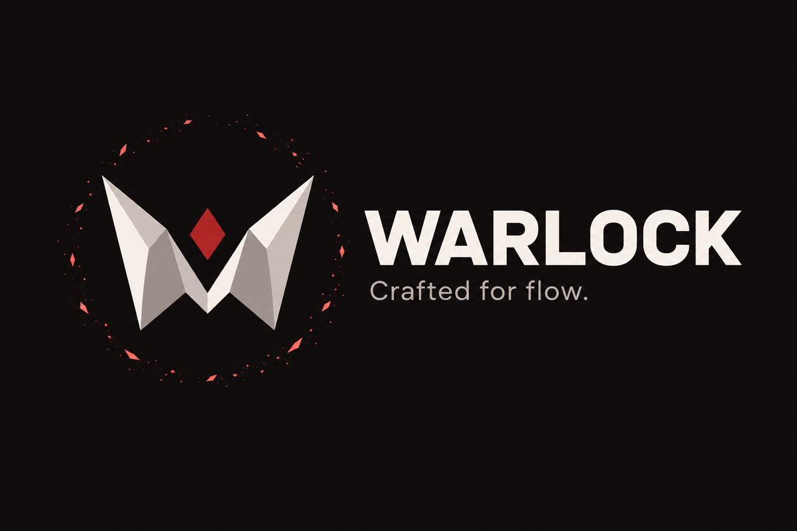
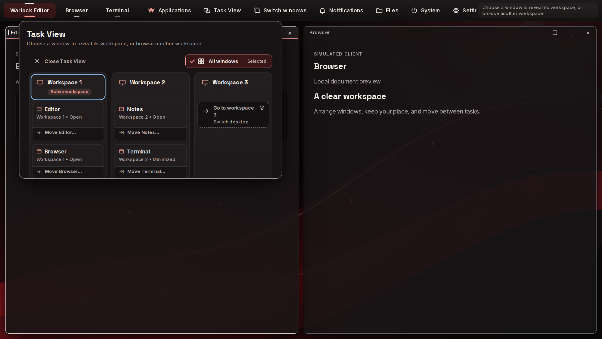
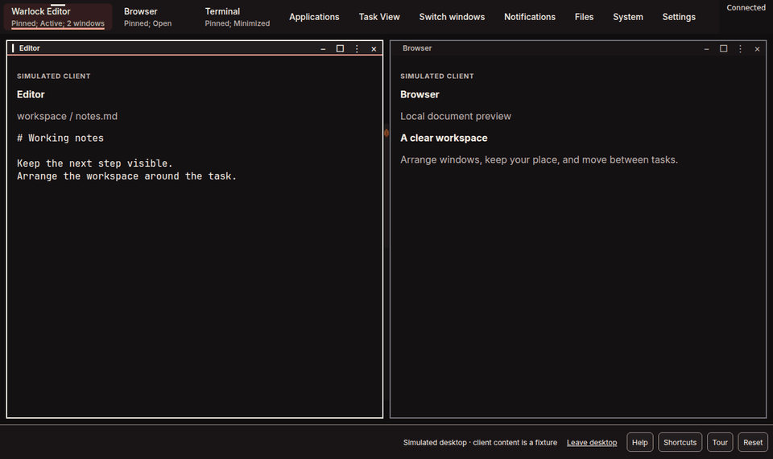
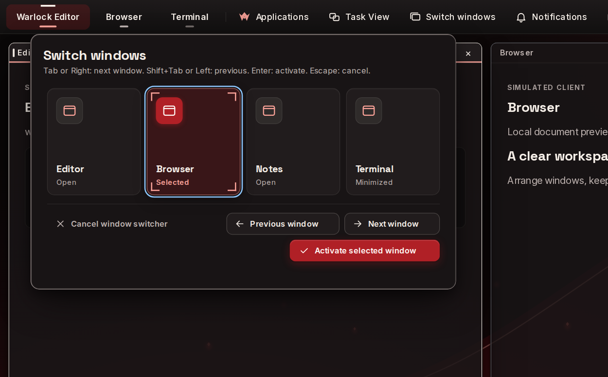
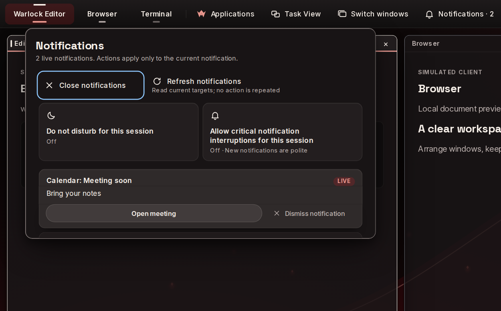
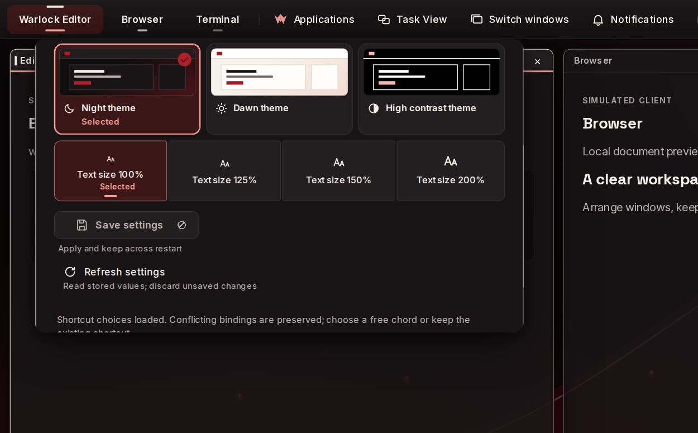
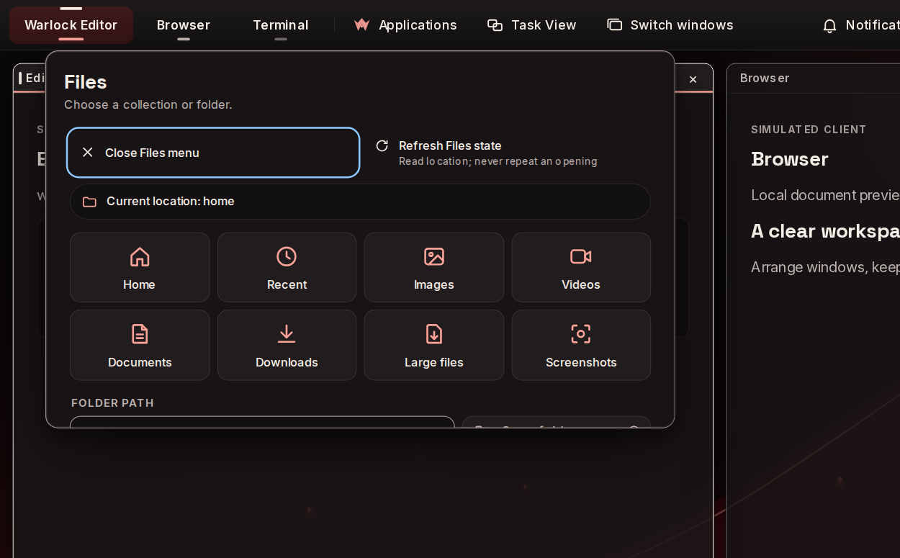
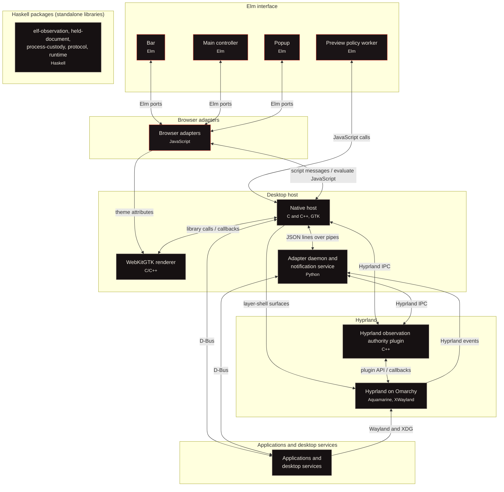
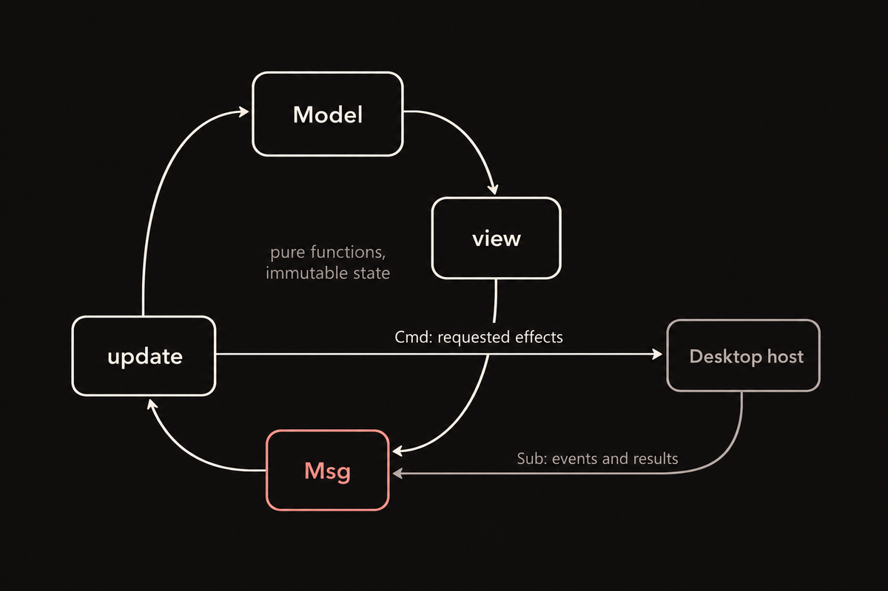
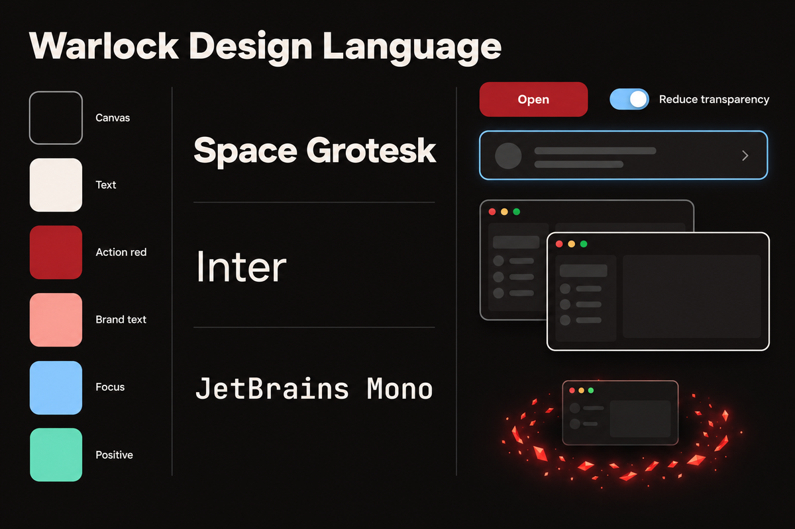

# Warlock



**Crafted for flow.**

Warlock is an Elm desktop shell for Omarchy, bringing a Windows-style taskbar and window controls to Hyprland. It brings applications, windows, workspaces, and desktop controls together in one interface.

**[Try the live test drive](https://charleshoskinson.github.io/Warlock/test-drive/) · [Visit the Warlock website](https://charleshoskinson.github.io/Warlock/)**

The test drive is the quickest way to try Warlock: the real compiled Elm interface on a simulated Omarchy desktop, right in your browser. Contributors build the native shell from source against matching Hyprland components, and a packaged Omarchy install is on the roadmap.



Open an application and Warlock's portal brings it in: a ring of red ember fragments ignites, expands and resolves into the new window.



## Why Warlock

Hyprland is a fast tiling compositor, and Omarchy makes it a pleasure to drive from the keyboard. Warlock adds the desktop layer around it: a taskbar that groups windows by application, a launcher, an Alt-Tab switcher, Task View across workspaces, window previews, a snap chooser, notification history, Settings, Files and a system menu. Warlock's own surfaces share one Elm interface, one design language and the same keyboard navigation, and Files opens in Omarchy's file explorer.

Window requests go to Hyprland, and Warlock shows the result Hyprland reports. When you pick a window, the taskbar marks the request as pending, Hyprland carries it out or refuses it, and the taskbar updates from what Hyprland reports.

Hyprland keeps doing what it does best: composing the desktop and managing input, focus, workspaces and window geometry.

## What it does

### Taskbar

A taskbar on each display keeps pinned applications and running window groups in reach. Open a group to find its windows and bring one forward.

### Launcher and application search

Open Applications from the taskbar and type a name to find an installed application. The top result has an Actions button with the application's own actions and its recent files.

### Window switcher

Use Alt-Tab to move through open windows. A clear highlight shows the selected window before you switch.



### Task View and workspaces

Open Task View from the taskbar to see windows organized by workspace. Select a window or move it to another workspace using the controls beside it.

### Window previews and snap layouts

Open a window group to recognize its windows by their previews, with icons when previews are unavailable. The snap chooser offers half-screen and quarter-screen positions for supported windows; Hyprland applies the resulting placement.

### Notifications

Open Notifications from the taskbar to read messages and their history. Act on a live notification, dismiss it, or turn on do not disturb.



### Settings

Open Settings from the taskbar to change appearance, text size, and motion. Review changes before saving them.



### Files

Open Files from the taskbar to reach Home, collections, or a folder you enter. Warlock opens the location in Omarchy Files and can reuse its existing window.



### System menu

Open System from the taskbar for volume, network, and session controls. The menu shows service state and asks for confirmation before actions such as restart, shutdown, logout, or disabling networking.

### Context menus and dialogs

Open a window's context menu for actions such as moving or arranging it. Dialogs identify consequential system actions and give you a way to cancel.

## Features

Checked items work in the desktop build. In the test drive, clicks, searches and settings run the same Elm code, and a simulated desktop answers in place of Hyprland and your applications.

### Taskbar and applications

- [x] Show a taskbar on each display
- [x] Group running windows by application
- [x] Pin applications to the taskbar
- [x] Reorder pinned applications
- [x] Mark active applications and applications needing attention
- [x] Search installed applications as you type
- [x] Launch an application from search
- [x] Open the first search result's application actions and recent files

### Windows and workspaces

- [x] Switch between windows with Alt-Tab
- [x] Select a window from its application group
- [x] Show windows by workspace in Task View
- [x] Move a window to another workspace
- [x] Show window previews with icon fallbacks
- [x] Choose a half-screen snap position
- [x] Choose a quarter-screen snap position
- [x] Open window actions from a context menu

### Desktop utilities

- [x] Read current notifications and notification history
- [x] Use actions on live notifications
- [x] Turn on do not disturb
- [x] Open Home and collections in Files
- [x] Open an entered folder in Files
- [x] Adjust volume and mute
- [x] View networking state
- [x] Confirm power and session actions

### Appearance and input

- [x] Choose the Night or Dawn theme
- [x] Change the shell text size
- [x] Adjust motion and visual effects
- [x] Navigate shell controls with the keyboard
- [x] Dismiss popups with Escape

## Try the test drive

Open the [live test drive](https://charleshoskinson.github.io/Warlock/test-drive/) in your browser. Search for an application, switch between windows, move a window in Task View, and explore the appearance settings without changing your desktop.

## How it works

### Architecture



[Explore the interactive architecture](https://charleshoskinson.github.io/Warlock/architecture/)

Follow one click. When you click the taskbar button of a window that is not focused, Bar checks the click against what it shows and passes it through its JavaScript adapter to the native host. The host routes it to Main, which turns it into an activation request and marks it pending. The host records the request and hands it to the Python adapter, which asks the Hyprland plugin to focus the window. The plugin focuses it inside Hyprland, checks the result and reports back along the same path. Main settles the request, and the taskbar shows the window as active once Hyprland's next window report arrives.

**Elm interface.** Main coordinates desktop interaction from a hidden controller document. Bar renders each display's taskbar, and Popup renders the shared menus and panels. Popup manages the window preview thumbnails, and a headless Elm worker inside the native host applies the preview policy.

**Browser adapters.** JavaScript connects Elm ports to browser input, native callbacks, appearance settings, and preview transport. The adapters start the Elm programs and pass messages between them and the host.

**Desktop host.** A shared GTK host written in C and C++ places the taskbars and popup. WebKitGTK runs compiled Elm and JavaScript and renders their HTML and CSS. A Python adapter subprocess connects the host to Hyprland and desktop services; a Python notification service receives application notifications and keeps their history.

**Hyprland integration.** A C++ plugin runs inside the matching Hyprland build, reports window state, handles window operations and shortcuts, and supplies captures. A C++ preview provider receives captures from the plugin and passes images through the host to the popup. Hyprland manages focus, input, workspaces, and window geometry; its C++ Aquamarine backend supplies display buffers and presentation.

**Applications and services.** Installed applications provide windows and desktop entries. XWayland connects X11 applications to the Wayland desktop. Omarchy Files, the audio service, NetworkManager, systemd-logind, desktop preferences, and local storage supply the services and data Warlock presents.

The Haskell packages in the diagram are standalone libraries, independent of the desktop runtime.

### Elm



The Elm Architecture gives each program a Model, messages, and an update function; programs that render an interface also have a view. Every change to a program's Model goes through update. Commands and subscriptions describe communication with the outside world, and the compiler checks that every case of every message is handled.

Main coordinates desktop interaction, Bar renders the taskbar for an output, and Popup renders shared panels while managing local text input and previews. This structure gives window state and user actions a clear place to meet.

### Haskell

Today's desktop build runs on the C/C++ host and the Python adapter shown above. Haskell is where Warlock's backend goes next: Elm owns everything you see and touch, and Haskell takes the parts that touch the system, namely supervising processes, preparing the interface's verified HTML, checking the dependencies of the binaries Warlock ships, and speaking a checked protocol with authenticated peers. Strong types, explicit effects and pure functions make those boundaries precise and testable.

Five packages in `implementation/warlock/haskell` already do those jobs as libraries, and the roadmap connects them into the persistent Haskell runtime the desktop runs on.

- `elf-observation` parses captured GNU `readelf` output and resolves declared dependency graphs.
- `held-document` reads identity-checked file snapshots and prepares HTML with verified content and script and style hashes.
- `process-custody` runs selected tools and child-process sessions with deadlines, controlled file descriptors, and cleanup tracking.
- `protocol` checks bounded bytes into a versioned envelope, records a refusal reason for rejected input, and provides a caller-owned framed socket transport.
- `runtime` is a controlled bootstrap that selects a held executable, keeps custody of the process it starts, and authenticates the current session's peer before admitting a frame.

### Warlock Design Language



The [Warlock website](https://charleshoskinson.github.io/Warlock/) documents every colour, type style, shape, motion and component. The test drive applies the design language to the real Elm interface, portal transitions included.

Black and red define Warlock's primary palette. Secondary colours communicate focus, status, positive outcomes, and warnings. A focused window stays subtly distinguishable from the windows around it, and depth and shadows remain legible on near-black surfaces.

The design language gives window opening and closing a signature portal transition: a ring of red ember sparks resolves into the window. Reduced-motion and effects-off versions provide quieter alternatives. Elm sets classes and data attributes; CSS owns the visuals. The typefaces are Space Grotesk, Inter, and JetBrains Mono.

## Roadmap

- [ ] Package Warlock for installation on Omarchy
- [ ] Provide an installation and rollback path
- [ ] Build the Haskell backend and native runtime integration
- [ ] Complete new-instance and window-pinning controls
- [ ] Expand input method support
- [ ] Extend screen reader and braille support
- [ ] Broaden multi-display and hardware coverage
- [ ] Complete reproducible release builds

## Build and contribute

Start with the offline contributor checker. It requires Python 3.9 or newer and Git. From the repository root, run:

```sh
python3 -B plugins/warlock-contributor/scripts/warlock.py status
python3 -B plugins/warlock-contributor/scripts/warlock.py check --project-only
```

The [frontend build instructions](docs/warlock/how-to/build-current-frontend.md) build Main, Bar, and Popup together. The documented build uses a compiler, package cache, and build launcher at paths on the development machine. A contributor on another machine needs equivalent inputs and a launcher. The [desktop build instructions](implementation/warlock/RELEASE.md) cover the native host and matching Hyprland components.

Current development now preserves window-action feedback while Applications is open, including older unresolved recovery; the narrow taskbar keeps the action-state prefix visible. See the [source-bound component evidence](implementation/warlock/qa/evidence/applications-window-feedback-20261031/report.json) and [feedback reference](docs/warlock/reference/applications-window-feedback.md). This is compiled Elm/browser component verification. Original native keyboard/AT and release acceptance remain open. New authored production is Elm/Haskell with every GUI element in Elm; the current replacement Haskell/native runtime remains under integration.

Original ARC005 authority-tuple serialization is [accepted on its permitted bridge oracle](docs/warlock-build-loop/v2/authority-tuple-acceptance-20261031.json), including source-bound traces and independent review. This does not qualify native mutation or the Haskell port.

The standalone Haskell packages use GHC 9.6.7 and installed dependencies. Follow the build and check instructions for [elf-observation](implementation/warlock/haskell/elf-observation/README.md), [held-document](implementation/warlock/haskell/held-document/README.md), and [process-custody](implementation/warlock/haskell/process-custody/README.md).

Run the checks for the components you change using their instructions and the [verification guide](docs/warlock/how-to/verify-selected-change.md). See the [contribution guide](CONTRIBUTING.md) for the workflow.

## License

Warlock is licensed under the [Apache License 2.0](LICENSE).
