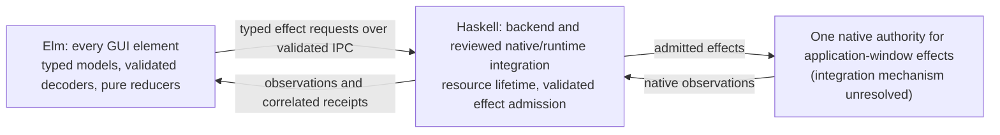
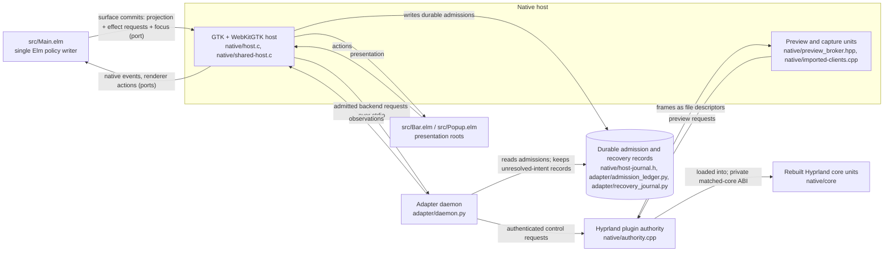

# Warlock

Warlock is a Linux desktop shell and window-system project for the Omarchy environment. It aims to give Hyprland a Windows-style taskbar, launcher, switcher, Task View, snapping, previews and menus. Under a 30 October 2026 project decision, the current architecture requires Elm for every GUI element and Haskell for authored backend and runtime integration, with one policy owner per decision and no shipped Python runtime ([language revision](docs/elm-roadmap/LANGUAGE-REVISION.md), [Elm and Haskell ownership](docs/warlock/explanation/elm-haskell-boundary.md)). The runnable integration candidate in this repository predates that decision: an Elm frontend in a C, GTK and WebKitGTK host, a Python adapter daemon and a C++ Hyprland plugin. Its evidence stays bound to its recorded source and does not qualify the replacement architecture. Numbered EARS requirements (explained under [EARS requirement status](#ears-requirement-status)) define the core behavioural baseline, alongside additive requirements and adopted product contracts, and a requirement counts as accepted only after an independent reviewer checks it against recorded evidence. Warlock is an **integration candidate under active development**. It is not a finished release, and it is **not installed in the main Omarchy session**.

Warlock is not:

- an installable release (release acceptance is a separate gate and is currently false);
- a Wayland compositor. Hyprland compatibility remains required, and any compositor replacement needs separate explicit feasibility admission ([OpenSpec project context](openspec/config.yaml); optional phases P7 and P8). The recorded candidate does modify Hyprland: `implementation/warlock/native/core/` holds modified Hyprland renderer, input and window sources, and native code must be loaded only on a reviewed, matching core/plugin tuple (see [Architecture](#architecture)). The release tuple remains unqualified: P6 release qualification has no accepted requirement. For the replacement, a Haskell host using an inventoried public compositor-library ABI is "a possible feasibility route" that "remains a proposal" ([ownership explanation](docs/warlock/explanation/elm-haskell-boundary.md#native-integration-remains-a-design-gate));
- a Windows API compatibility layer ("Windows parity" means the project's own behaviour inventory; see the [roadmap scope](docs/elm-roadmap/ROADMAP.md));
- a signal-based FRP system (it uses today's Elm Architecture; see [Functional reactive programming (FRP)](#functional-reactive-programming-frp) below and the [FRP research note](docs/research/elm-pivot/FRP.md)).

## Status at a glance

**As of commit fc5cef02f (30 October 2026).** Counts come from the [delivery ledger](docs/warlock-build-loop/v2/requirement-ledger.json), updated 2026-10-30 07:51 UTC. They are evidence dispositions, not a count of finished features.

| | Accepted | Partial | In progress / implemented-unverified | Unadjudicated | Total |
| --- | ---: | ---: | ---: | ---: | ---: |
| EARS requirements | **9** | 47 | 2 in progress | 184 | **242** |
| Scenarios | **28** | 94 | 2 implemented-unverified | 293 | **417** |

These counts cover only the baseline in [requirements.json](docs/elm-roadmap/requirements.json) (242 requirements, 417 scenarios). The ELM-RC-* right-click candidates, the ELM-ADOPT-* design-adoption contracts, the design-language WARLOCK-DL-* requirements and the production-language WARLOCK-LANG-* requirements are tracked separately and are not included; see [packets outside the baseline](#ears-requirement-status) under EARS requirement status.

- **Release accepted:** no. **Installed in the main Omarchy session:** no, and a GitHub merge does not deploy the desktop.
- **Architecture:** the Elm and Haskell target is in preparation. A Muse-supervised preparation loop is armed, while final product implementation and native acceptance campaigns remain gated ([STATE.json](docs/warlock-build-loop/v2/STATE.json)). Muse, an owner-appointed AI regulator, checks continuity and original EARS fidelity every 20 minutes and has no product integration or acceptance authority ([AGENTS.md](AGENTS.md), [instructions](docs/warlock-build-loop/v2/INSTRUCTIONS.md#muse-regulation-and-recovery)). The published Haskell preparation libraries cover [held document snapshots](implementation/warlock/haskell/held-document/README.md) and [bounded ELF observations and declared dependency graphs](implementation/warlock/haskell/elf-observation/README.md). Their protected CPU checks do not establish a runnable replacement GUI or native acceptance.
- **Accepted on recorded tuples:** taskbar group listing, activation and restore requests, pin order across a shell restart, attention indicators, launcher search, launch and refusal recovery, settings migration, and two bridge and protocol requirements. These acceptances belong to the recorded candidate's source tuples; no acceptance transfers automatically to a replacement implementation.
- **Open:** keyboard context-menu reopening still hits a retained WebKit renderer failure. The full New instance journey, application pin versus always-on-top, IME candidate selection and cancellation, and broader screen-reader and braille behaviour are incomplete. Restore cancellation is not wired into the normal host. Release packaging is blocked on redistribution and notice reviews, and Omarchy rollback is unproven.
- **Unadjudicated means old evidence has not been audited yet.** It does not mean the behaviour is absent.

Dated progress notes are in [Current checkpoints](#current-checkpoints), the last section of this README.

## Desktop surfaces

The recorded candidate in [implementation/warlock/](implementation/warlock/README.md) contains the surfaces below ([list](DesignLanguage/CURRENT.md)). A surface being present is not acceptance. The second column gives the ledger's word for the main original requirements.

| Surface | Ledger status |
| --- | --- |
| Taskbar: groups, activation, restore, pins, attention | ELM-UX-004, ELM-UX-005, ELM-UX-008, ELM-UX-009 **accepted**; ELM-UI-004 in progress (all 6 scenarios accepted; New instance and pin-versus-top obligations open) |
| Window-action feedback (Pending, Refused, Unknown; defined under [FRP](#functional-reactive-programming-frp), step 3) | ELM-UI-007 in progress |
| Launcher search and launch | ELM-UI-005, ELM-UX-029 **accepted** |
| Alt-Tab switcher | ELM-UI-003, ELM-UX-012 to ELM-UX-014 partial; ELM-UX-011 unadjudicated |
| Task View and workspaces | ELM-UI-006, ELM-UX-017, ELM-UX-018, ELM-UI-002 partial |
| Snap selection | ELM-UX-019, ELM-UX-020 partial |
| Window previews | ELM-UX-007 (unavailable-preview fallback) partial; ELM-UX-006 (historical minimized preview) unadjudicated |
| Always-on-top and maximize | ELM-UX-016 partial |
| Jump lists and menus | ELM-UX-010, ELM-UI-008 partial; the wider [right-click contract](docs/elm-roadmap/RIGHT-CLICK.md) is a specification candidate |
| Appearance and motion settings | Storage requirement ELM-DEL-015 **accepted**; ELM-UX-030 and reduced motion ELM-UX-022 partial |
| Notification centre and system menu | ELM-UX-031, ELM-UX-032 partial |
| Files (installed explorer) | ELM-UX-033 partial; optional Elm Files replacement ELM-UX-034 unadjudicated |

The visual language (folded-W brand, layered-window shading, focus halo, high contrast and effects-off modes) is in [DesignLanguage/](DesignLanguage/README.md). Its [browser catalog](DesignLanguage/catalog/index.html) holds frozen v6 specimens that are qualified only for their recorded browser scope, which is not native design adoption.

## Architecture

The repository distinguishes the **target architecture** set by the 30 October language revision from the **recorded candidate**, kept with its predecessors as evidence, each acceptance bound to its recorded source and evidence tuple; none qualifies the target.

### Target: Elm GUI, Haskell backend

Every GUI element, including presentation, controls and views, is Elm. Its pure update functions own visible interaction state and describe requested effects. Haskell owns native capabilities, resource lifetime, validated effect admission and runtime integration, and supplies pure policy where selected. Each decision has exactly one owner: a Haskell policy and an Elm projection must not become competing effect owners, and moving a native mechanism into Haskell must not create a second implementation of Elm's window-action policy ([migration design](openspec/changes/warlock-production-language-migration/design.md), [ownership explanation](docs/warlock/explanation/elm-haskell-boundary.md)). The revised ELM-ARC-002 assigns "DOM presentation and all GUI elements to Elm, backend and native host integration to Haskell, and application-window effects to one native authority".



A correlated request must keep its session, original selection, full-width identities and original monotonic deadline through admission, native execution, observation and durable terminal acknowledgement. Dependent effects are sequenced through matching committed receipts and only independent effects are batched; Unknown outcomes are reconciled, never replayed ([WARLOCK-LANG-002](openspec/changes/warlock-production-language-migration/specs/production-language-policy/spec.md)). Elm-generated JavaScript is a compiler artifact, and inventoried third-party and system libraries and development tools are kept separate from authored production. Authored components outside Elm and Haskell need real replacements; wrapping them is insufficient. The loop instructions say reviewed Elm GUI source is eligible for reuse with current-source qualification ([loop instructions](docs/warlock-build-loop/v2/INSTRUCTIONS.md#muse-regulation-and-recovery)).

**Still unresolved** ([ownership explanation](docs/warlock/explanation/elm-haskell-boundary.md#native-integration-remains-a-design-gate)):

- **Native integration is a design gate.** The replacement must preserve the original atomic commit/cancellation and resource-retirement obligations. A command socket and later state notifications have not established that contract, and reclassifying Warlock-authored legacy native mechanisms as external dependencies would not satisfy the language requirement.
- **Host feasibility.** A bounded isolated Haskell host probe stopped after two qualification-only iterations. The last failed on an unreviewed mapped system library, and no host, Elm-ready or normal-retirement pass is inferred. No third attempt is allowed ([STATE.json](docs/warlock-build-loop/v2/STATE.json)).
- **Interface.** STATE.json records private qualification results for interface semantic revision 2.1 (wire version 2), with no authenticated native issuer, real certificate or retirement, filesystem durability, full implementation correspondence or original or native acceptance inferred.
- **The final implementation loop is gated.** Rearming implementation requires reviewed architecture and native feasibility, versioned Elm/Haskell interfaces, protected Quint, correspondence and fuzz results, aligned current specifications, a reviewed workflow plugin and a truthful checkpoint ([language revision](docs/elm-roadmap/LANGUAGE-REVISION.md)).

### Recorded candidate (current source)

The candidate's intended ownership boundary separates *deciding* from *doing*: Elm chooses actions, and native code owns protocol safety, capabilities, resource lifetimes, execution and observations, checking that a request still applies to the current window and grant before carrying it out and reporting what happened ([architecture decision](docs/warlock-build-loop/v2/ARCHITECTURE-DECISION.md), a proposed target dated 29 October 2026, before the language revision). Not every current interaction completes that full lifecycle yet.



All paths in the diagram are under `implementation/warlock/`.

- **Elm policy.** `Main.elm` is the only policy writer. Native events, renderer actions and output topology arrive through ports. It updates the output controller and publishes surface commits through the `surfaceCommits` port. Each commit (a `view-commit` packet built in `OutputController.elm`) carries the view projection together with the effect requests and focus targets. The host validates the commit, handles host-local requests itself (an explicit host-reconnect request goes to `backend_restart()` inside the host and never reaches the daemon) and forwards admitted backend requests to the adapter daemon. `Main.elm`'s own view is empty. `Bar.elm` and `Popup.elm` render what they are given and report input. They own display state, input composition (Popup also holds IME composition, the pending query and preview paint-gate state) and renderer acknowledgements, but they choose no window actions.
- **Native host.** `host.c` and `shared-host.c` (which textually includes `host.c`) make up the host. It uses GTK, gtk-layer-shell and WebKitGTK, hosts the Elm roots in web views, relays their messages, owns shell surface lifetimes and starts the Python backend as a child process.
- **Adapter daemon.** `daemon.py` owns one authenticated effect-authority client. Each control request is a separate authenticated call over Hyprland's control socket (`endpoint.py` opens and closes the socket per request, checking the peer process), and a separate event socket drives refresh. The daemon routes requests to catalog, notification, Files, system-menu, workspace and other services. It returns observations and is not a second policy engine.
- **Durable admission and recovery records.** The host keeps a private admission journal: `host.c` includes `host-journal.h`, whose header states "Durable admission belongs to the host; authoritative settlement to the broker." In the daemon, the default store (`delivery_ledger.py`, through `retirement_ledger.py`) builds on `admission_ledger.py`, which reads those host admissions ("Admissions are observation evidence; neither import nor recovery replays effects") and refuses to begin a submission that has no matching durable host admission. `durable_ledger.py` describes itself as "Bounded durable unresolved intents. An observation store, never a retry queue", and `recovery_journal.py` holds one durable uncertain window intent, "never an executable retry queue". `daemon.py` imports `recovery_store.py`, which selects the legacy store or the opt-in cancellation store and calls its recovery frames informational only. On recovery, retained unresolved entries come back with status Unknown, and `reconciliation.py` re-announces only records that are durably Unknown, so an uncertain intent is retained for reconciliation and is not replayed as a command. Opt-in Restore-cancellation custody lives in `cancellation_ledger.py` and `cancellation_coordinator.py`, with the native decision owner in `native/effect_cancellation.hpp`. That store "does not enable the daemon or frontend cancellation route", and the normal host configuration does not enable this mode ([cancellation protocol](docs/warlock/reference/cancellation-protocol.md)).
- **Compositor authority.** `authority.cpp` is a Hyprland plugin. Its initialisation refuses to start when the owning and client Hyprland header hashes differ. Separately, the project requires a reviewed exact core/plugin/Aquamarine ABI tuple before native code is loaded; matching a version number alone is not enough ([candidate README](implementation/warlock/README.md)).
- **Compositor core.** `implementation/warlock/native/core/` holds replacement translation units for parts of Hyprland's own renderer, input, window, keybind and placement code (for example `Renderer.cpp`, `InputManager.cpp`, `Window.cpp`), together with Warlock policy headers such as `CommittedScene.hpp` and `ModalRecipient.hpp`. Changed native units must compile and relink with reviewed source, dependency, provider and ABI identities ([Verify a selected change](docs/warlock/how-to/verify-selected-change.md)). For example, the QA recipe [check-scene-core.py](implementation/warlock/qa/check-scene-core.py) compiles `Renderer.cpp`, `ViewHitTester.cpp` and `InputManager.cpp` against the owning core's headers, swaps them into a copy of that core's library archive and relinks a Hyprland binary. The plugin uses a private matched-core ABI, so a rebuilt core and the plugin must stay paired. The release builder's recorded run rebuilt the Elm roots and host units against a retained core/plugin tuple and states no upstream native-core rebuild ([STATE.json](docs/warlock-build-loop/v2/STATE.json)).
- **Preview and capture.** Window previews are a large native subsystem. Host code such as `preview_broker.hpp`, `imported-clients.cpp` and `preview-provider-bootstrap.cpp` requests previews and receives frames from capture code in the plugin (`preview_capture.hpp`, `capture-resources.hpp`). By design, a capture broker authorizes each preview against the source's current incarnation and output generation, frame bytes and native handles stay outside Elm ports, the frontend gets an opaque capability scoped to its epoch, source incarnation and output generation, and native code keeps ownership of buffers until they are retired ([capture, motion and graphics ownership](docs/elm-roadmap/ARCHITECTURE.md#capture-motion-and-graphics-ownership), a design proposal). On the Elm side, modules such as `PreviewLifecycle.elm` track preview presentation, preview commands and retirement. Authorized native picker previews have bounded recordings; full transition, resource and release acceptance remain open ([elm-capture-motion capability spec](openspec/changes/elm-desktop-pivot/specs/elm-capture-motion/spec.md)).

The intended effect lifecycle runs from user input or a native fact, through the owning Elm transition, to a new model and a proposed effect, then native admission and execution, then a correlated observation back to Elm. This is an architecture model, not an assurance that every current interaction completes the full path. Ports carry the messages but do not guarantee ordering or exactly-once delivery, and an Unknown outcome never permits a blind retry. See [ownership and lifetimes](docs/warlock/explanation/ownership-and-lifetimes.md), the [full architecture](docs/elm-roadmap/ARCHITECTURE.md) and the proposed [layering contract](docs/elm-roadmap/LAYERING.md).

The [Haskell process custody package](implementation/warlock/haskell/process-custody/README.md) now passes a fresh offline strict build and its focused internal/public tests under protected CPU QA. It exposes opaque ownership and deadline types; trusted lease issuance remains separate. Focused tests now also cover selected descriptor inheritance and exclusion of ambient files and sockets. These checks do not establish native window behavior or full release readiness.

The development-only [capture receiver](implementation/warlock/qa/ELM-HASKELL-CAPTURE.md) now preserves and independently checks bounded image evidence even when the capture child exits unsuccessfully. Its synthetic-image CPU checks do not establish real GUI rendering or native acceptance.

The controlled Elm/Haskell launch now has real cgroup migration and escaped-process cleanup checks. Two changed-composition qualification trials failed before the Elm host started: no image was acquired, and owned resources were released without forced termination. The second observed a backend-creation failure message, with the underlying cause still unknown. The diagnostic campaign is stopped under its two-attempt rule; independent implementation work continues and the final implementation loop remains gated.

## Why Elm and Haskell

The [migration proposal](openspec/changes/warlock-production-language-migration/proposal.md) gives the 30 October 2026 project decision itself as the reason for the change. The contract each language must meet is set out in the migration design and specification.

**Why Elm for the GUI.** Unfinished Windows-style behaviour and observed layering failures in the earlier shell motivated the proposed Elm pivot, which centralises typed presentation and policy in Elm ([pivot proposal](openspec/changes/elm-desktop-pivot/proposal.md)). The [design philosophy](docs/warlock-brand/PHILOSOPHY.md) asks for "one coherent account of the desktop": user intent and observed state live in one typed model, and every change is an explicit event. WARLOCK-LANG-002 requires every GUI element to use Elm "with typed models, validated decoders, pure reducers and explicit typed effects". What Elm contributes ([Elm practices](docs/elm-roadmap/ELM-PRACTICES.md)):

- **Pure updates over immutable values.** The same inputs give the same model and the same effect descriptions, so transitions can be replayed, compared with Quint models and tested in small fixtures.
- **Custom types with exhaustive cases.** States such as Pending, Refused and Unknown are distinct constructors in `Effects.elm`. The compiler checks that case expressions are exhaustive, so handlers can explicitly distinguish the states.
- **Effects as data.** Reducers describe external work and do not perform it.
- **Pinned Elm and package versions.** `implementation/warlock/elm.json` pins `elm-version` 0.19.2 and its package versions. That file does not identify the compiler executable: the held compiler and package cache are identified separately by the reviewed input lock used in [Build the current frontend](docs/warlock/how-to/build-current-frontend.md).

**Why Haskell for the backend.** The migration design assigns Haskell native capabilities, resource lifetime, validated effect admission and runtime integration, plus pure policy where selected. The [Haskell engineering skill](plugins/warlock-languages/skills/haskell-engineering/SKILL.md) states how that code should be written: pure transition and reducer policy kept separate from IO interpreters; newtypes, smart constructors and algebraic data types "to make invalid states unrepresentable"; total pattern matching in preference to partial functions; bracketed resource acquisition; STM for concurrent shared state where appropriate; bounded queues; and a distinction between cancellation requests and observed native retirement.

What these choices do not do:

- **They do not make the whole system failure-free.** Ports carry foreign JSON that must be decoded and validated; malformed or unsupported envelopes must be refused at the boundary. ELM-ARC-004 is accepted for its original malformed or unsupported-envelope requirement on its recorded source and bridge evidence. It excludes live compositor, native GUI and release acceptance and is not a guarantee for all foreign JSON. In the project's words, "HLS diagnostics and pure properties do not prove native IO", and compiler or library passes "do not prove native input, AT, IME or presentation behavior".
- **Elm is not a window system.** In the recorded candidate, Elm compiles to JavaScript for a browser engine and native code owns surfaces, input, capture and drawing order. The replacement's native integration is unresolved (see [Architecture](#architecture)).
- **Elm brings no speed claim.** The [pivot research](docs/research/elm-pivot/README.md) found no evidence that Elm in a web view is faster or cheaper than the earlier Qt Quick shell. Performance is a trade-off to measure.

## Functional reactive programming (FRP)

**What FRP is.** Functional reactive programming is a way to write interactive programs by describing values that change over time and the events that change them. Classic FRP distinguishes continuous *behaviours*, such as a pointer position, from discrete *events*, such as a key press, so an animation is a description of a value over time rather than a sequence of imperative frame steps.

**What Elm is today.** Early Elm was built on time-varying signals. Elm removed them in version 0.17 in favour of *The Elm Architecture*: a model, discrete messages, a pure update that computes the next model from each arriving message, a view computed from the model, and commands and subscriptions managed by the runtime. Warlock uses this modern form and not the historical `Signal` API. The [FRP research note](docs/research/elm-pivot/FRP.md) explains the difference and why continuous motion stays native.

**How Warlock applies it.** The steps below describe the recorded candidate's Elm source. WARLOCK-LANG-002 keeps the same contract for the replacement frontend: committed-receipt sequencing, batching of independent effects only, and unchanged native authority, cleanup and no-replay semantics.

1. **Events in.** `Main.elm` wraps each incoming port value in a typed Elm message; the JSON payload is decoded at the owning domain boundary (for example in `Desktop.elm`). Timers also produce internal deadline messages.
2. **Pure transition.** `Desktop.elm` defines `update : Msg -> Model -> ( Model, List Effect )`. Each step returns a new model and a list of effect descriptions, with no side effects.
3. **Requests out, receipts back.** Each window effect is in one of five states ([ownership and lifetimes](docs/warlock/explanation/ownership-and-lifetimes.md)):
   - **Pending:** emitted by Elm, not yet resolved; native admission is separate.
   - **Committed:** native reports it done.
   - **Refused:** natively, or locally by `Effects.locallyRefuseUnsent` on its caller's proof: an authenticated preflight-unsent certificate or, separately, `OutputController.elm` proving its register call omitted the commands. A refusal alone does not prove nothing changed.
   - **Cancelled:** withdrawn; not by itself proof that native state is unchanged.
   - **Unknown:** the outcome is not known, for example after a disconnect, so the action may or may not have happened. It stays unresolved until a correlated outcome or validated recovery supplies evidence, and it is never retried automatically.

   Each window effect carries request, generation, incarnation and context identities. `Effects.elm` accepts a receipt only when its intent and effect protocol exactly match an unresolved entry. It refuses mismatched receipts and receipts for intents already settled by a terminal receipt or a local refusal, and an Unknown receipt keeps the intent unresolved for reconciliation. Settings, catalog, pin and launch outcomes have their own handlers in `Desktop.elm`. For window effects, terminal receipts update transaction state; an admitted, revision-checked scene snapshot updates the observed scene.
4. **Identity binding.** A launcher selection is bound to the host, model revision, catalog lifetime and generation, and `Launch.elm` rejects stale selections before an intent is emitted. Native catalog validation follows, and the ELM-UI-005 acceptance is separately bounded.
5. **Dependent work must wait for evidence.** A batch of Elm commands does not promise result ordering, so dependent work must wait for its protocol's actual prerequisite observation, never a guessed completion ([ownership and lifetimes](docs/warlock/explanation/ownership-and-lifetimes.md)). This is a required design rule. [ELM-PRACTICES.md](docs/elm-roadmap/ELM-PRACTICES.md) gives restore-then-focus as the required pattern: focus is emitted only after the matching committed receipt. The original dependency requirement, ELM-ARC-008, and its four scenarios are unadjudicated in the ledger, and the 30 October native cancellation fixture lists ARC008 dependency scheduling as remaining open ([fixture limits](implementation/warlock/qa/evidence/native-cancellation-client-20261030/LIMITS.md)).
6. **Replay.** `Replay.elm` accepts a list of window-effect inputs, folds them through `Effects.apply`, and outputs an encoded model projection, effect and error for each step. It does not establish native movement or presentation.

Limits: [ELM-PRACTICES.md](docs/elm-roadmap/ELM-PRACTICES.md) ties demand-sensitive subscription lifetimes to visible consumers and active transactions, while keeping native control journals, cancellation, receipts and revocation active; `Main.elm` currently subscribes unconditionally to its listed ports. The fuller replay and typed-boundary contracts (ELM-ADOPT-001 and related) are [consensus drafts](openspec/changes/elm-design-adoption/design.md) whose implementation and qualification are still open.

## How Warlock achieves assurance

Work is linked to the applicable original requirements and verified with evidence appropriate to each obligation ([loop instructions](docs/warlock-build-loop/v2/INSTRUCTIONS.md)). The layers below describe that intended workflow, and each states what it does not prove. Passing through a layer is not the same as completed acceptance: the ledger still holds partial and unadjudicated rows.

| Layer | What it does | What it does not prove |
| --- | --- | --- |
| 1. EARS requirement | One structured sentence with a stable ID in the [registry](docs/elm-roadmap/requirements.json) ([readable form](docs/elm-roadmap/REQUIREMENTS.md)); the 30 October revision reworded the implementation language and ownership of five requirements, and the pre-revision register is preserved | Listing a requirement says nothing about implementation or acceptance |
| 2. Scenarios and traceability | GIVEN/WHEN/THEN scenarios in the OpenSpec capability specs (for example [elm-host](openspec/changes/elm-desktop-pivot/specs/elm-host/spec.md)). [TRACEABILITY.md](docs/elm-roadmap/TRACEABILITY.md) maps each requirement to a phase, task and planned verifier and links to the requirement section that holds its scenarios | TRACEABILITY.md is a planning baseline, not the live ledger; its "All acceptance is pending" line is stale, because the ledger has since recorded acceptances |
| 3. Quint models | Abstract state machines checked with bounded sampled runs, invariants, named tests and reachability witnesses ([window-behavior models](window-behavior-spec/README.md), feature models such as [gesture-end.qnt](implementation/warlock/qa/gesture-end.qnt)) | A sampled pass is not a proof, and an abstract model is not live compositor behaviour |
| 4. Contracts, replay, fuzzing | Required practices for applicable changed boundaries: validated opaque types, explicit boundary errors, production-route property and sequence tests with reproducible seeds and retained counterexamples ([policy](docs/warlock-build-loop/v2/FUZZING-CONTRACTS.md)). Actual coverage and retained results are whatever the relevant evidence records show | The policy does not assert that a fuzz runner is installed; types and generated tests do not prove native delivery, lifetimes or pixels |
| 5. Protected native evidence | Serial campaigns on isolated compositor fixtures, on a pinned source and ABI tuple, collecting the native, pixel, input, accessibility and cleanup observations the specific oracle requires ([test strategy](docs/elm-roadmap/UI-UX-TEST-STRATEGY.md); launch requirements in the [loop instructions](docs/warlock-build-loop/v2/INSTRUCTIONS.md#protected-execution-and-authority)) | One isolated fixture is not a full journey, hardware, AT/IME or usability evidence |
| 6. Independent acceptance | An independent reviewer checks the evidence against the original oracle. The loop instructions require an acceptance record to contain the original oracle and verification scope, immutable evidence and its hash, the source tuple and the independent reviewer's disposition; ledger rows carry some of these directly and link to the supporting evidence and reviews. Partial, failed, blocked and other dispositions are recorded too | Holds only for the recorded scope and tuple |
| 7. Release acceptance | A separate whole-product gate (see release gates under [Roadmap](#roadmap) below and the completion requirements in the [loop instructions](docs/warlock-build-loop/v2/INSTRUCTIONS.md)) | Currently **false** |

Evidence must match the original verification text: where a requirement says "native **or bridge**", bridge evidence is enough, while keyboard, AT, physical presentation and hardware claims need the evidence each names. A scenario closes only when its own obligations pass, and a requirement only when all applicable scenarios and verification obligations pass ([loop instructions](docs/warlock-build-loop/v2/INSTRUCTIONS.md)). Acceptance never transfers between implementations: an Elm or Haskell replacement must be mapped to each original behavioural oracle and qualified on its own source-bound evidence ([migration design](openspec/changes/warlock-production-language-migration/design.md)). Separately, [verify_snapshot.py](tools/verify_snapshot.py) checks archived files against their inventory; that is integrity, not behaviour.

## EARS requirement status

**EARS** (Easy Approach to Requirements Syntax) writes each requirement as one sentence using structured patterns, so the expected behaviour and, where applicable, its trigger or condition are explicit ([patterns](docs/elm-roadmap/REQUIREMENTS.md)):

| Pattern | Form | Example |
| --- | --- | --- |
| Ubiquitous | The … SHALL … | ELM-REV-007: "The bridge SHALL encode authority identities, generations, revisions and absolute native deadlines as lossless schema-defined canonical strings…" |
| Event-driven | WHEN …, the … SHALL … | ELM-UX-005: "WHEN a taskbar group is opened, the Elm desktop SHALL list each eligible window incarnation once and route selection to that incarnation." |
| State-driven | WHILE …, the … SHALL … | ELM-UX-009: "WHILE native observations mark a window active or attention-requesting, the Elm desktop SHALL expose distinct active and attention indicators." |
| Unwanted behaviour | IF …, THEN the … SHALL … | ELM-ARC-004: "IF an envelope is malformed or has an unsupported protocol version, THEN the Elm desktop SHALL reject it without a native effect and record the rejection reason." |
| Optional feature | WHERE …, the … SHALL … | ELM-UX-034 (a later Elm Files replacement) |
| Complex | combined clauses | one requirement |

**Status words.**

| Word | Meaning in the ledger |
| --- | --- |
| **accepted** | Independently reviewed against the original EARS requirement and its scenarios, on a recorded source tuple with immutable evidence; bounded to that scope |
| **partial** | Some relevant behaviour or evidence exists, but acceptance obligations remain open |
| **in-progress** | A requirement being advanced; not accepted |
| **implemented-unverified** | A scenario implementation whose verification is incomplete |
| **unadjudicated** | Older evidence not yet audited; it does **not** mean the behaviour is absent |

Scenario rows can also be marked missing, failed or blocked. Requirement acceptance and release acceptance are separate fields, and accepted administrative requirements (such as the bridge and protocol rows) are not GUI features.

**Counts can go down.** Acceptance is pinned to source and evidence hashes. When a relevant source change lands, the affected evidence must be re-reviewed and an accepted row can be revoked. Unrelated accepted rows are not invalidated automatically.

**Requirements and scenarios are counted separately.** Of the 28 accepted scenarios, 18 belong to the nine accepted requirements. The other ten belong to requirements not yet accepted: six under ELM-UI-004 and four under ELM-ARC-007. ELM-UI-004 shows the difference: all six of its scenarios are accepted, but the requirement stays in progress because explicit New instance launching and application pin versus native always-on-top independence are still open.

**The language revision.** On 30 October a governed [language revision](docs/elm-roadmap/LANGUAGE-REVISION.md) ([machine-readable changes](docs/elm-roadmap/language-revision.json)) changed the implementation wording of five requirements: ELM-ARC-002, ELM-DEL-003, ELM-DEL-012, ELM-REN-023 and ELM-TEA-005. All 242 requirement identities, 417 scenario objects and every verification statement are unchanged, and the pre-revision register is preserved as a [baseline](docs/elm-roadmap/baselines/requirements-pre-language-20261030.json) with SHA-256 a0c2093cc7769e05b70cc81aa3c001dbcbffe936cc17d1c494d7ab2fdc8b3b1b. None of the five is accepted in the ledger.

**Packets outside the baseline.** The [loop instructions](docs/warlock-build-loop/v2/INSTRUCTIONS.md) set an outcome that also covers additive right-click requirements and the FRP/Elm and design-language contracts adopted into scope, and they keep the design-language and FRP adoption plans as product constraints. None of the packets below is counted in the tables that follow:

- **Right-click requirements** (ELM-RC-\*): an additive amendment candidate, "specification only", whose identifiers stay separate until a reviewed amendment maps them into delivery ([RIGHT-CLICK.md](docs/elm-roadmap/RIGHT-CLICK.md)).
- **Design-adoption contracts** (ELM-ADOPT-\*; typed boundaries, replay, ownership, cancellation, recovery and related contracts): consensus research drafts whose implementation and qualification tasks remain unchecked ([design](openspec/changes/elm-design-adoption/design.md)).
- **Design-language requirements** (WARLOCK-DL-\*): a consensus candidate with implementation and native qualification open ([DesignLanguage/EARS.md](DesignLanguage/EARS.md)).
- **Production-language requirements** (WARLOCK-LANG-001 and WARLOCK-LANG-002): the allowed authored languages and the functional frontend and typed-effect contract, added by the [production-language migration](openspec/changes/warlock-production-language-migration/specs/production-language-policy/spec.md); its readiness, authorization and first-replacement tasks are unchecked.

**Overall:** 242 requirements (9 accepted, 47 partial, 2 in progress, 184 unadjudicated; 226 *must* and 16 *conditional*, with all 9 accepted ones *must*). 417 scenarios (28 accepted, 94 partial, 2 implemented-unverified, 293 unadjudicated).

| Requirements by phase | Total | Accepted | Partial | In progress | Unadjudicated |
| --- | ---: | ---: | ---: | ---: | ---: |
| P0 | 20 | 0 | 2 | 0 | 18 |
| P1 | 40 | 2 | 3 | 0 | 35 |
| P2 | 58 | 1 | 6 | 0 | 51 |
| P3 | 26 | 4 | 7 | 2 | 13 |
| P4 | 36 | 0 | 7 | 0 | 29 |
| P5 | 27 | 2 | 18 | 0 | 7 |
| P6 | 23 | 0 | 4 | 0 | 19 |
| P7 (optional) | 3 | 0 | 0 | 0 | 3 |
| P8 (optional) | 9 | 0 | 0 | 0 | 9 |
| **All** | **242** | **9** | **47** | **2** | **184** |

| Requirements by EARS pattern | Total | Accepted | Partial | In progress | Unadjudicated |
| --- | ---: | ---: | ---: | ---: | ---: |
| Ubiquitous | 107 | 3 | 14 | 2 | 88 |
| Event-driven | 83 | 4 | 27 | 0 | 52 |
| Unwanted | 20 | 1 | 2 | 0 | 17 |
| State-driven | 17 | 1 | 4 | 0 | 12 |
| Optional | 14 | 0 | 0 | 0 | 14 |
| Complex | 1 | 0 | 0 | 0 | 1 |

By capability, the accepted requirements fall in elm-taskbar (4 of 11), elm-native-bridge (2 of 29), elm-shell-experience (2 of 23) and elm-security (1 of 11); the other eleven capabilities have none. The [delivery ledger](docs/warlock-build-loop/v2/requirement-ledger.json) records each requirement's capability, and capability names match the OpenSpec specs under [openspec/changes/elm-desktop-pivot/specs/](openspec/changes/elm-desktop-pivot/specs/).

**The nine accepted requirements.** Each is bounded by the scenarios, evidence and source tuple in the ledger, and none accepts the release.

| ID | Phase | What was accepted | Stated limits |
| --- | --- | --- | --- |
| ELM-ARC-004 | P1 | Malformed or unsupported envelopes refused with no native effect, reason recorded | Finite native-or-bridge traces; no actual compositor, native GUI, deployment or AT/IME claim |
| ELM-REV-007 | P1 | Identities, generations, revisions and deadlines encoded as lossless canonical strings | No claim about the native clock, retry or continuous GUI transport |
| ELM-DEL-015 | P2 | Versioned, validated settings with a preserved pre-migration copy (4 scenarios) | Interrupted two-link backup publication stays a fail-closed limitation; native settings journeys separate |
| ELM-UX-004 | P3 | Application pin identity and order survive a shell restart | Not the separate pin versus always-on-top behaviour |
| ELM-UX-005 | P3 | In the original three-window example, the three entries appeared once (labels revealed by real keyboard scrolling) and only the selected incarnation was activated | That recorded source/native tuple; not every group membership or selection |
| ELM-UX-008 | P3 | Requests activation or restore through native authority without moving the selected eligible window to a scratchpad; the recorded restore route was observed | Observed route; other-output, partial-refusal and AT cases separate |
| ELM-UX-009 | P3 | Distinct active and attention indicators, with native pixels and AT-SPI observations | Exact composed tuple; wider AT, output, theme and scale matrix separate |
| ELM-UI-005 | P5 | Launcher results bound to the current query and catalog generation, with ranking, empty, unavailable and refusal recovery (5 scenarios) | Earlier observations stay on their original tuples; no IME, audible or braille output |
| ELM-UX-029 | P5 | One identity-bound launch request, with visible failure feedback on refusal | No universal catalog correctness, AT/IME or main-session deployment |

## Roadmap

The [roadmap](docs/elm-roadmap/ROADMAP.md) (a reviewed plan dated 3 October 2026) sets out nine phases, and the [sprint plan](docs/elm-roadmap/SPRINTS.md) splits the mandatory ones into work packages S01 to S16. Cycle numbers carry no dates or staffing forecast. The loop instructions now set the outcome as one coherent Warlock window system "in Elm and Haskell" over the same scope.

| Phase | Goal |
| --- | --- |
| P0 | Freeze baseline, inventory, protocol proposal, workloads and budgets; diagnose existing compositor layering |
| P1 | Compare isolated GTK/WebKit and Qt hosts: surface roles, bridge, focus, IME, popups, crash recovery |
| P2 | Elm policy model; versioned event, intent and receipt contract; replay; stale, cancel and restart faults |
| P3 | Taskbar and switcher slice: metadata, groups, actions, global Alt chord routing |
| P4 | Minimized previews, retained frames, minimize/restore motion, reversal, capture retirement |
| P5 | Complete shell: Task View, snap, workspaces, launcher, menus, settings, themes, accessibility, IME, multiple outputs |
| P6 | Release qualification: one coherent tuple, performance, packaging and licence review, reversible activation and rollback |
| P7 | *Optional:* compositor feasibility study and go/no-go decision (the revised P7 requirement ELM-REN-023 asks for a documented Haskell native execution boundary and Elm GUI and typed policy interface before any replacement is implemented) |
| P8 | *Optional:* native compositor with Elm policy, only after a P7 go decision |

**Where work stands.** Work does not proceed strictly phase by phase: the accepted requirements fall in P1, P2, P3 and P5, while P0 has none. The two in-progress requirements are ELM-UI-004 (taskbar actions) and ELM-UI-007 (visible action states). The build-loop [state file](docs/warlock-build-loop/v2/STATE.json), whose update stamp reads 2026-10-30 15:10 UTC, still names "native-restore-cancellation" as the active slice, selected in commit 7b1b42d58 after a regulator review found the previous selection, the already accepted ELM-UX-009, stale. It targets three P2 requirements, none of them accepted: in the ledger ELM-ARC-007 is partial (four of its five scenarios accepted, receipt-cancelled unadjudicated), ELM-ARC-008 is unadjudicated and ELM-ARC-012 is partial. Its listed paths are the candidate's Python adapter files. The [loop instructions](docs/warlock-build-loop/v2/INSTRUCTIONS.md#muse-regulation-and-recovery) now add that the superseding language decision requires replacement Elm/Haskell components against the same cancellation, admission and settlement contracts, and that forbidden-language production integration must not continue.

**Preparation before the final loop.** Later commits on 30 October added a preparation-loop record to STATE.json without changing that timestamp. It records preparation mode as armed for architecture and native feasibility, interface and readiness source, tooling and the full workflow plugin, EARS/OpenSpec alignment, and Quint correspondence and fuzz preparation, with final implementation and native campaigns both recorded as not authorized. Its stated next independent action is to "Implement and qualify concrete Haskell durable custody IO over the corrected pure owner". Design and interface work by ten AI agents is authorized ([language revision](docs/elm-roadmap/LANGUAGE-REVISION.md)), and [AGENTS.md](AGENTS.md) lets root (the coordinating AI agent, not Unix root) run bounded isolated native capability trials needed to establish readiness, permitting neither main-desktop changes nor acceptance of unobserved original obligations. The migration's [task list](openspec/changes/warlock-production-language-migration/tasks.md) has two of six items checked; readiness review, tooling readiness, authorization and the first independently qualified replacement remain open.

**Next slices (a dated list).** STATE.json still carries a `nextSlices` list written on 7 October 2026 (commit b804a874b) and not edited since, so it predates the 28 to 30 October acceptances and the language revision: taskbar activation/minimize/restore and popup focus journeys; persistent catalog pins; launcher search and refusal recovery; switcher/Task View/workspaces and snap/output journeys; authorized visible previews and fallback; settings/notifications/Files/right-click and design-language/Omarchy adoption; original native, AT/IME, hardware/resource/journey gates; reproducible package, reversible deployment/rollback. The first three overlap in part with requirements since accepted on bounded tuples: ELM-UX-008, ELM-UX-004 and ELM-UI-005. For acceptance status, use the [delivery ledger](docs/warlock-build-loop/v2/requirement-ledger.json).

**Release gates.** Completion needs all applicable original scenario oracles, one reproducible source/core/plugin/toolchain tuple, representative journeys, native presentation and input, AT/IME, measured resource and performance budgets, and reversible deployment and rollback with drafts preserved. A bounded feature can be accepted earlier, but component passes never add up to a release ([loop instructions](docs/warlock-build-loop/v2/INSTRUCTIONS.md), [release closure tasks](openspec/changes/elm-release-closure/tasks.md), [release contract](implementation/warlock/RELEASE.md)).

**Older documents.** These remain useful for scope, but the ledger overrides them on status, and the current language decision ([migration design](openspec/changes/warlock-production-language-migration/design.md)) supersedes them on implementation language:

- [ROADMAP.md](docs/elm-roadmap/ROADMAP.md), 3 October 2026: a planning change that completes no milestone by itself; it still describes "a native host and command authority".
- [ARCHITECTURE.md](docs/elm-roadmap/ARCHITECTURE.md): a design proposal whose component table still lists a JavaScript adapter. [ARCHITECTURE-DECISION.md](docs/warlock-build-loop/v2/ARCHITECTURE-DECISION.md), 29 October 2026: its decision to "Keep the existing Elm authority and native compositor integration" predates the Elm/Haskell requirement.
- [FEATURE-COMPLETION.md](docs/warlock-roadmap/FEATURE-COMPLETION.md), headed "Updated 10 October 2026": a feature-completion checklist. [CURRENT.md](DesignLanguage/CURRENT.md), headed "Updated 8 October 2026" with 10 October entries: surface list and design guidance.
- [TRACEABILITY.md](docs/elm-roadmap/TRACEABILITY.md): the original baseline mapping each requirement to a phase, task and planned verifier. Its blanket statement that "All acceptance is pending" is stale.
- [docs/HANDOFF.md](docs/HANDOFF.md) and [PARITY_STATUS.md](window-behavior-spec/PARITY_STATUS.md): archival records.

## Building and testing

There is **no documented one-command ready user installation** ([build and runtime reference](docs/warlock/reference/build-and-runtime.md)). The commands and linked procedures below check or build parts of the recorded candidate; no Haskell package or Cabal project is published yet. The reviewed frontend build needs a reviewed input lock, the held compiler and package cache, machine-local absolute paths and the protected launcher ([Build the current frontend](docs/warlock/how-to/build-current-frontend.md)). Native campaigns separately need reviewed source, dependency, provider and ABI identities and protected, serialised execution ([Verify a selected change](docs/warlock/how-to/verify-selected-change.md)). These are the commands the repository documents. They are not a portable installer.

After cloning, fetch large files stored in Git LFS (see `.github/PUBLISHING.md`):

```sh
git lfs pull
```

Offline contributor checks, from the repository root:

```sh
python3 -B plugins/warlock-contributor/scripts/warlock.py status
python3 -B plugins/warlock-contributor/scripts/warlock.py remaining --summary
python3 -B docs/warlock-build-loop/v2/loop.py --record .warlock-contributor/ACTUAL_RECORD.json check   # beginning and end of each product implementation continuation
python3 -B plugins/warlock-contributor/scripts/warlock.py --repo "$PWD" check --project-only   # before and after explicitly requested documentation/support changes
```

Replace the ACTUAL_RECORD.json placeholder with the path of your actual owned participant record. Both the contributor CLI and the loop wrapper default to a slice.json record under .warlock-contributor, and that default can be a stale historical record ([build and runtime reference](docs/warlock/reference/build-and-runtime.md)).

- **Frontend:** Main, Bar and Popup are rebuilt together from a reviewed input lock through the protected launcher; see [Build the current frontend](docs/warlock/how-to/build-current-frontend.md).
- **Release builder:** builds the Elm roots and native host units, then runs host self-tests and a compiled reducer regression; see [RELEASE.md](implementation/warlock/RELEASE.md) and [Check release reproducibility](docs/warlock/how-to/check-current-release-reproducibility.md).
- **Proportionate checks:** compile what changed (the loop instructions now name changed Haskell packages and actual Elm entry points) and run the decisive behaviour and one negative or lifecycle case. For changed concurrency, authority or reducer invariants, include reproducible sequence fuzzing and applicable Quint correspondence. See [Verify a selected change](docs/warlock/how-to/verify-selected-change.md) and [Retrofit existing code](docs/warlock/how-to/retrofit-existing-code.md).
- **Language tooling inventory:** [tools.json](tooling/languages/tools.json) lists Elm 0.19.2, GHC 9.6.7, Haskell Language Server 2.4.0.0, HLint 3.6.1, Fourmolu, elm-test 0.19.2-1, QuickCheck and OpenSpec 1.15.0 as development tools, and states that installation and small compiler checks are support evidence and that native architecture still requires proof.
- **Native GUI campaigns** run one at a time through the loop wrapper, which checks your contributor record before and after. Pass your actual owned participant record explicitly, because the wrapper's default record path can point at a stale historical record:

  ```sh
  python3 -B docs/warlock-build-loop/v2/loop.py --record .warlock-contributor/ACTUAL_RECORD.json native --runner /absolute/reviewed/runner.py
  ```

  Never load a plugin against a compositor with a different owning ABI, and keep the five safeguards in the [crash-noise handoff](docs/crash-noise/HANDOFF-codex-window-qa.md).
- **Snapshot integrity:** `python3 -B tools/verify_snapshot.py --revision HEAD`.
- **Omarchy trials** need draft preservation and rollback prepared first, and run isolated when the main session is not ready. Do not edit `/usr/share/omarchy`. See the [offline recovery profile](implementation/warlock/RECOVERY.md).

A passing model, CPU or browser check does not establish native acceptance.

## Repository layout

| Path | Contents |
| --- | --- |
| [implementation/warlock/](implementation/warlock/README.md) | The only editable product candidate: Elm sources (src), native host and plugin (native), replacement Hyprland compositor-core sources (native/core), Python services and release tooling (adapter), assets, QA checks, models and evidence (qa), and release catalogs (release) |
| `implementation/` (other directories) | Frozen earlier versioned candidates and reports, referenced by hash |
| [docs/](docs/warlock/index.md) | Current documentation (`docs/warlock/`), delivery workflow and ledger (`docs/warlock-build-loop/v2/`), requirements, language revision and roadmap (`docs/elm-roadmap/`), research, brand and historical handoffs |
| [openspec/](openspec/changes/) | Behaviour specifications and change proposals, including the production-language migration |
| [DesignLanguage/](DesignLanguage/README.md) | Design guidance, layered-window contracts, browser catalog |
| [plugins/warlock-contributor/](plugins/warlock-contributor/README.md) | Contributor checker and skills, packaged for Claude Code, Codex and Grok |
| [plugins/warlock-languages/](plugins/warlock-languages/README.md) | Codex plugin with the elm-engineering and haskell-engineering skills |
| [tooling/languages/](tooling/languages/tools.json) | Development-tool inventory for the Elm and Haskell toolchains |
| [wiki/warlock/](wiki/warlock/_index.md) | Versioned journal of lessons, ideas and decisions; source and ledger stay authoritative |
| [window-behavior-spec/](window-behavior-spec/README.md) | Earlier Windows-behaviour audit and requirements ([requirements.md](window-behavior-spec/requirements.md)), Quint models with their QA suite and results ([QA.md](window-behavior-spec/QA.md)), model-based replay scripts, versioned design and campaign directories, and status history ([PARITY_STATUS.md](window-behavior-spec/PARITY_STATUS.md)) |
| [window-integration-qa/](window-integration-qa/README.md) | Shared launch contract for native and nested QA runs: `qa_run.py` starts each runner in its own user scope under qa-harness.slice, limiting core dumps except in diagnostic `--backtrace` runs, and `qa_launch.py` holds the shared scope and private-runtime checks. Also versioned private-host and nested-session harnesses, and preflight, source-review and replay records, including retained failed evidence |
| [installed/](installed/) | Snapshots of deployed home and system components |
| [src/](src/) | Related compositor, plugin, Quickshell, Qt and accessibility source trees |
| [evidence/](evidence/) | Earlier QA reports and prototype artifacts |
| [provenance/](provenance/) | Source mappings, SHA-256 inventories, upstream Git archives |
| [tools/](tools/) | Snapshot capture and integrity verification |
| .github, .agents, .claude-plugin | Publishing notes, pull-request template, plugin marketplace metadata, OpenSpec agent skills |

Preserve historical evidence and its original identities, deadlines and ABI references. Reference unchanged artifacts by hash, and create fresh evidence when the claim requires it ([loop instructions](docs/warlock-build-loop/v2/INSTRUCTIONS.md), [repository record](docs/warlock-repository/v1/README.md)).

## Documentation map

The [Warlock documentation](docs/warlock/index.md) follows [Diátaxis](https://diataxis.fr/):

- **Tutorials:** [first evidence-grounded contribution](docs/warlock/tutorials/first-contribution.md), [navigate a policy-to-native route](docs/warlock/tutorials/source-navigation.md).
- **How-to guides:** [contribute a selected slice](docs/warlock/how-to/contribute-selected-slice.md), [retrofit existing code](docs/warlock/how-to/retrofit-existing-code.md), [build the frontend](docs/warlock/how-to/build-current-frontend.md), [validate a composition](docs/warlock/how-to/validate-current-composition.md), [verify a change](docs/warlock/how-to/verify-selected-change.md), [read recorded evidence](docs/warlock/how-to/read-recorded-evidence.md), plus the cancellation test guides.
- **Reference:** [build and runtime](docs/warlock/reference/build-and-runtime.md), [status and evidence](docs/warlock/reference/status-and-evidence.md), [settings storage](docs/warlock/reference/settings-storage.md), [cancellation protocol](docs/warlock/reference/cancellation-protocol.md).
- **Explanation:** [Elm and Haskell ownership](docs/warlock/explanation/elm-haskell-boundary.md) (the target and its native readiness gate), [authority, presentation and lifetimes](docs/warlock/explanation/ownership-and-lifetimes.md), [taskbar attention](docs/warlock/explanation/taskbar-attention.md), [application pin and always-on-top](docs/warlock/explanation/application-pin-and-always-on-top.md).

For a detailed narrative of the recorded candidate, read the [candidate README](implementation/warlock/README.md); consult the [delivery ledger](docs/warlock-build-loop/v2/requirement-ledger.json) and its linked evidence for authoritative acceptance and exact source tuples ([status and evidence](docs/warlock/reference/status-and-evidence.md)). For the language change, read the [language revision](docs/elm-roadmap/LANGUAGE-REVISION.md) and the [production-language migration](openspec/changes/warlock-production-language-migration/proposal.md). For previews and capture, read the [capture, motion and graphics ownership](docs/elm-roadmap/ARCHITECTURE.md#capture-motion-and-graphics-ownership) design and the [elm-capture-motion capability spec](openspec/changes/elm-desktop-pivot/specs/elm-capture-motion/spec.md). Also see the [retrofit debt register](docs/warlock-build-loop/v2/RETROFIT.md), the [Elm architecture research](docs/warlock-build-loop/v2/ELM-ARCHITECTURE-RESEARCH.md) and the [brand identity](docs/warlock-brand/README.md).

## Contributing

Start with [CONTRIBUTING.md](CONTRIBUTING.md), [AGENTS.md](AGENTS.md) and the [Warlock contributor plugin](plugins/warlock-contributor/README.md). Its offline checker works with Claude Code, Codex, Grok or no AI client at all. A plugin pass shows structural compliance and never counts as GUI acceptance. New iterations use progress policy 5, which counts changed selected Elm source in existing product roots and Haskell `.hs` source in src, native or adapter; generated Elm output, QA, models and documentation do not count. The plugin's [workflow reference](plugins/warlock-contributor/references/redesign-flow.md) describes design-readiness work, which does not need a fabricated product slice.

For Elm and Haskell work, the [language skills plugin](plugins/warlock-languages/README.md) is installed in Codex with:

```sh
codex plugin marketplace add /absolute/path/to/Warlock
codex plugin add warlock-languages@warlock
codex plugin list --json
```

Skill installation and bounded tooling checks do not accept production behaviour.

For new product-slice work, [CONTRIBUTING.md](CONTRIBUTING.md) gives this sequence (product implementation is currently gated; see [Roadmap](#roadmap)):

1. Plan and declare a small slice with your own record: `plan` → `preflight --slice-file` → `start --slice-file` (`preflight` is a structural preview of the saved plan that writes no files, takes no ownership and runs no QA; see the [contributor plugin README](plugins/warlock-contributor/README.md#scaffold-and-resume)). A slice names 1 to 3 original requirement IDs, exact scenario names, before and after behaviour, source paths and the decisive check. Run the beginning loop check (`loop.py --record <your record> check`) after starting the record.
2. Implement in `implementation/warlock/`, preserving other contributors' files, original deadlines, Unknown/no-replay handling and ABI pairing.
3. Build the changed targets and run the decisive behaviour plus a relevant negative or lifecycle case. Native campaigns go through the protected, serialised loop runner (`loop.py native --runner`, shown under Building and testing). Use the plugin's `record` command to write down what was observed, what failed and what is still missing.
4. Run the ending loop check (again with your own `--record`) and `review` before committing. The pull-request template, `.github/PULL_REQUEST_TEMPLATE.md`, asks for the user action and resulting behaviour, original EARS IDs and scenario names, source ownership, decisive verification and evidence, failed checks and missing observations, and any independent verdict.

Explicitly requested documentation/support changes use proportionate validation with `warlock.py check --project-only` before and after; they do not need a fabricated GUI slice.

Ledger acceptance is recorded only when the original oracle and verification obligations are satisfied and independently reviewed; partial, failed, blocked and other dispositions are recorded as well. **No AI attribution in commits or pull requests** ([AGENTS.md](AGENTS.md)). Design work follows the [design contribution guide](DesignLanguage/CONTRIBUTING.md).

## Reporting problems

The repository is published at [github.com/CharlesHoskinson/Warlock](https://github.com/CharlesHoskinson/Warlock). The checked-in tree has no root or .github security policy or issue template, and [CONTRIBUTING.md](CONTRIBUTING.md) does not specify a bug-reporting route. If its GitHub issue tracker is available to you, that is a suggested route. A useful report gives the commit you tested, whether it ran in an isolated trial or a desktop session, what you did, what you expected and what you saw (with logs or screenshots), and the original requirement or scenario ID if you know it. Do not reproduce problems by running native campaigns against your main desktop session; use the protected, isolated route above.

## Licence

The published tree has **no root-level licence file**. Subtree licence files should not be treated as a repository-wide grant; project licence grants and redistribution decisions remain unresolved ([candidate README](implementation/warlock/README.md)). The current packaging campaign stopped on 12 redistribution and seven notice-applicability decisions. Until each is reviewed, the compliance gate blocks the candidate archive; a partial package directory and its report can remain ([review](implementation/warlock/release/COMPLIANCE.md)).

## Current checkpoints

- **30 October 2026 — Haskell source integration.** The bounded ELF parser and declared dependency graph now live in the checkout with their pure controls. A fresh private Cabal build and test suite passed offline with repositories disabled and compiler warnings treated as errors. The test package includes ten hash-recorded retained text fixtures and reads no private state path. A generated source archive also passed a fresh private offline build and test after extraction. The earlier build-flag failure is retained in the [qualification record](implementation/warlock/haskell/elf-observation/qualification.json). This is preparation-library verification; original scenario counts and native stop histories are unchanged.

Dated integration notes, oldest first, each bounded to its recorded evidence and dated by its evidence record. New checkpoints are appended at the end of this section.

- **28 October 2026.** The ELM-REV-007 (canonical-string bridge codec) scenario accepted on its recorded protocol tuple. By this date all six original ELM-UI-004 taskbar scenarios, ELM-UX-005 and ELM-UX-008 were accepted; ELM-UI-004 itself stays in progress.
- **29 October 2026.** Launcher: ELM-UX-029 accepted (one identity-bound launch, with painted success and painted refusal feedback), and whole ELM-UI-005 accepted including refusal recovery, with earlier race, removed, no-match and unavailable observations kept on their original tuples.
- **29 October 2026.** ELM-UX-004 accepted: two applications kept their identities and order across a real shell restart. Application pin versus always-on-top stays open.
- **29 October 2026.** ELM-ARC-004 (malformed-envelope refusal) accepted on bridge evidence. ELM-REV-007 accepted as a whole requirement on the current-source protocol tuple, with no claim about the native clock or continuous GUI transport.
- **29 October 2026.** Omarchy: an isolated trial started the installed predecessor (menu, workspaces, clock) with full owned-process cleanup. A later full private-profile trial selected the candidate, which exited with code -6 before readiness, so draft preservation and rollback were not reached.
- **30 October 2026.** ELM-UX-009 (attention indicators) accepted on the exact composed tuple with native pixels and AT-SPI observations ([limits](implementation/warlock/qa/evidence/attention-native-composed-20261030/LIMITS.md)). The release composition's isolated build A stopped on outstanding redistribution and notice reviews, with no archive or build B ([selection limits](implementation/warlock/qa/evidence/current-release-selection-20261030/LIMITS.md)).
- **30 October 2026.** Application pin versus always-on-top: both current native trials failed overall (the first after 165 passing assertions, the second at 194 of 195), and the real AT action was refused before invocation. Five application-pin saves plus pointer pin and keyboard unpin preserved the other authority, with normal cleanup. That evidence authorizes no further trials, and the ELM-UI-004 independence obligation stays open ([pin/top limits](implementation/warlock/qa/evidence/pin-top-current-20261030/LIMITS.md)).
- **30 October 2026.** ELM-DEL-015 (settings storage and migration) accepted on the recorded tuple. Restore cancellation gained a native lifecycle backend and a strict client, which a bounded compositor-only private fixture exercised after loading plugin 12959a5d into owning core b1c58200 with Aquamarine 667a22d5 ([fixture limits](implementation/warlock/qa/evidence/native-cancellation-client-20261030/LIMITS.md)). Separately, an opt-in durable coordinator was added and tested only against real stores and strict native-schema response doubles, not a loaded plugin ([coordinator limits](implementation/warlock/qa/evidence/cancellation-coordinator-20261030/LIMITS.md)). The normal host does not enable the coordinator. Host/Elm routing, physical Escape and native resource retirement remain open, the coordinator has no live-transport evidence, and the fixture is not a refreshed full composition or a deployment ([cancellation protocol](docs/warlock/reference/cancellation-protocol.md)).
- **30 October 2026.** Restore cancellation backend: each new reservation now requires an exact durable host admission pair (a Submitted companion and its matching Pending admission); companion-only orphan records are excluded from legacy projection and settlement; typed retirement receipts are emitted before the native acknowledgement; and reusing the same target requires a durable settlement-cache receipt joined to its stored certificate. Protected public-source runs passed nine store groups, three coordinator groups and six focused cache, certificate, orphan, pair, reader and fault groups; the six focused groups use explicit C cache-writer and native-response doubles ([paired backend limits](implementation/warlock/qa/evidence/cancellation-host-cache-20261030/LIMITS.md)). A separate source and model review recorded bounded correspondence for the published Python component only; that reviewer ran no QA or model ([correspondence review](implementation/warlock/qa/evidence/cancellation-backend-correspondence-20261030/REVIEW.md)). The normal host gate stays disabled. The owning C cache consumer, the Elm route, physical Escape, the original deadline origin and native resource retirement remain open, and no scenario, whole-requirement or release acceptance changed.
- **30 October 2026.** Language revision: the current architecture requires Elm for every GUI element and Haskell for authored backend/runtime integration. The [language revision](docs/elm-roadmap/LANGUAGE-REVISION.md) rewords five requirements and preserves all 242 requirement identities, 417 scenario objects and original verification statements. Existing native evidence stays bound to its recorded source and does not qualify the replacement architecture.
- **30 October 2026.** Preparation checkpoint: the Muse-supervised preparation loop is active. The final implementation loop remains gated on reviewed native feasibility, the versioned interface, specification alignment and workflow verification ([ownership and unresolved native integration decisions](docs/warlock/explanation/elm-haskell-boundary.md)). A bounded isolated Haskell host feasibility probe stopped after two qualification-only iterations; the last failed on an unreviewed mapped system library, both reports retained containment (runtime gone, no cleanup errors, no remaining descendants), which is not normal acceptance, and no third attempt is allowed ([STATE.json](docs/warlock-build-loop/v2/STATE.json)). A development-only Quint model of the intended Elm/Haskell HTTP transport owner passed, with Quint 0.33.0 and seed 20261030, all 20 selected original tests, three post-free regression tests and seven invariant samples of 1,000 traces; neither full-action sample (10,000 and 100,000 traces) observed expiry, and both failed coverage records are retained. It is not a native implementation or acceptance of an original scenario ([HTTP owner model](implementation/warlock/qa/http-owner/README.md)). No scenario, requirement or release acceptance changed.

<!-- Append new dated checkpoints above this line. -->
