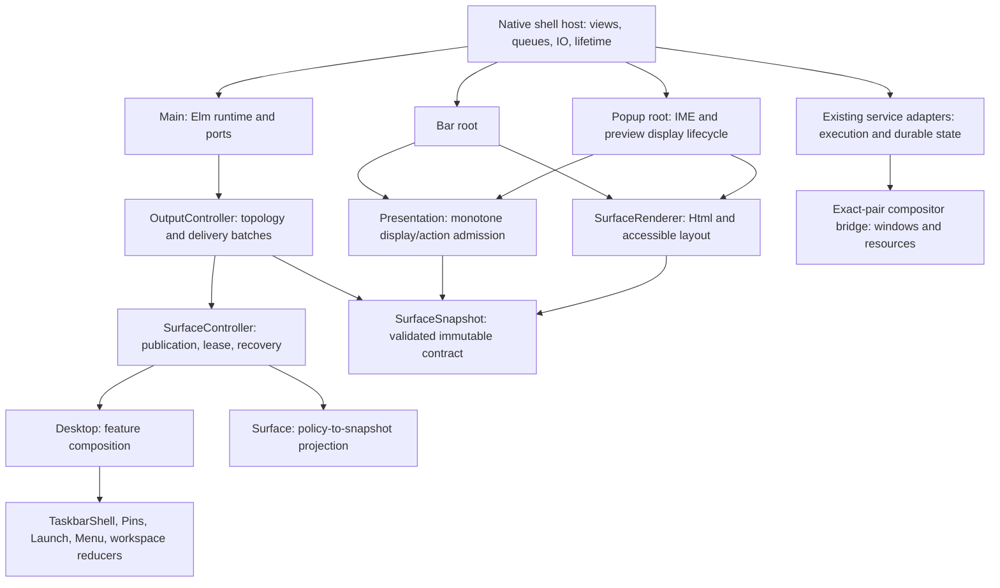

# Warlock architecture: one policy authority, explicit native ownership

Status: proposed target and implementation-ready first slice, 2026-10-29. Astra supervision with Terra research; not a GUI acceptance report. This document records the reviewed proposed target and the first selected migration. The proposal and source reviews did not change product files or run native QA. Implementation status is recorded in STATE and the candidate README.

## Decision

Keep the existing Elm authority and native compositor integration. Refactor the dependency boundaries around validated immutable values, scoped native resources, and explicit runtime lifetimes. Keep `Main`, `Bar`, and `Popup` as distinct Elm entry points with one policy writer: `Main` owns policy; the other roots own display state, input composition, and renderer resource acknowledgements. Three roots do not mean three policy authorities.

First remove the concrete policy-to-HTML dependency by extracting `SurfaceSnapshot` from `SurfaceRenderer`. Then isolate the current native host's resource-owning subsystems and consolidate the current build recipe. Do not begin with a toolkit replacement, process proliferation, directory renaming, or a universal component framework.

The intended product remains Windows-like window management with Warlock branding and Omarchy conventions. GNOME and KDE inform engineering boundaries; their interaction models do not replace the original requirements.

## Non-negotiable product and proof invariants

* ELM-UI-004: zero/single/group taskbar behavior, inactive activation, active minimize, minimized restore, exact group member selection; new instance must not duplicate launches. Application pinning and window always-on-top remain separate operations.
* ELM-UX-004: persistent application pins and order survive restart. Persistence belongs to a native storage effect with observed completion, not to a view's local state.
* ELM-UX-005: a group selection addresses the exact current window identity, not just an application label or list index.
* ELM-UX-006/007 and ELM-UI-016: minimized historical preview remains useful without claiming live content; icon/title fallback belongs to the right identity; loading, authorized historical, current live, and unavailable are visually and accessibly distinguishable. Changing a label cannot turn stale pixels into current pixels.
* The full original 242 requirements / 417 scenarios, mandatory S01-S16, right-click additions, FRP/design-language contracts, optional feasibility gates, original deadlines and frozen oracles remain intact.
* Elm chooses actions. Native code owns protocol safety, capabilities, resource lifetimes, execution, and observations. A native admission check is not permission to invent another taskbar/window policy.
* Unknown delivery is not failure and does not permit repeating a potentially applied effect. Current bindings, generations, publication/lease, canonical UInt64 strings, original effect identity, and retirement rules remain mandatory.
* Preserve the exact core/plugin/Aquamarine ABI tuple; original protected QA and serial native launcher; drafts and main compositor. Model, CPU, native, AT/IME, resource, and release evidence remain separate claims.

## What the source already does

Graphify navigation used `warlock-ctx q` before bounded source reads. The graph returned partial/truncated neighborhoods; source verification controls these findings.

| Source | Verified ownership or problem |
| --- | --- |
| `src/Main.elm:29-68` | A small authority adapter holds `OutputController.Model`, routes port values, calls update/register, commits one packet, and maps four typed deadline effects to timers. Its view is empty. Splitting this file for size would buy little. |
| `src/OutputController.elm:19-38` | Owns host-issued view scopes, topology/owner selection, revisions, outstanding batches, and the one `SurfaceController.Model`. |
| `src/SurfaceController.elm:18-38` | Owns publication/lease and recovery around `Desktop.Model`; invokes `Desktop.update` and projects `Surface.packet`. |
| `src/Desktop.elm:1-40` | Composes existing feature modules such as TaskbarShell, Pins, Launch, Menu, Switcher, Files, workspace and motion policy. Existing domain reducers should be retained and clarified rather than recreated in native code. |
| `src/SurfaceRenderer.elm:13-88` | Owns the validated snapshot type, strict bounded decoder, canonical encoding, identity/accessor functions, pending query projection, and action-envelope construction **in the same module as Html rendering**. |
| `src/OutputController.elm:73,77,177,249` | Imports the Html renderer only to decode/read publication and lease. This is a concrete reversed dependency. |
| `src/Presentation.elm:9-59` | Owns monotone snapshot acceptance and captured-action/query admission, but imports SurfaceRenderer for the snapshot contract. |
| `src/OutcomeAnnouncements.elm:3,18,60`, `src/Announcement.elm:3-11,23,46` | Outcome policy imports `Announcement.Message`/`encodeMessage` from a module also owning Html view and importing SurfaceRenderer. This is a second, transitive policy-to-presentation edge; Snapshot extraction alone does not remove it. |
| `src/Bar.elm:16-24`, `src/Popup.elm:32-46` | Separate presentation roots. Popup additionally owns IME composition, pending query and preview presenter/paint gate state. Those are renderer-local facts, not permission to choose native window actions. |
| `native/shared-host.c:4` | Textually includes `host.c`; main/shared hosting therefore share globals/static callbacks through a translation-unit mechanism. Changing lifecycle ownership here needs a later bounded native extraction. |
| `adapter/release_builder.py:23-35,76-83,205-235,557-570` | Already has a fixed native-unit list and hash-locked build. Capture enumerates broad candidate source trees; the Elm entry-point mapping and native recipe appear in multiple places. Consolidation can reduce build drift, but cannot discard recorded provenance by changing a list. |
| `adapter/release_repro.py:42-89` | Already stages only locked files and aliases and builds in an isolated namespace. Preserve this useful machinery; do not replace it with an unverified fresh packaging system. |

Paths above are relative to `implementation/warlock/`. These describe inspected source, not complete acceptance. Dirty `native/host.c`, candidate README and root diagnostic work are outside this proposal's edit ownership.

## Lessons from official GNOME, KDE, and Elm sources

GNOME separates native Mutter facilities, reusable scene/widget primitives, and shell UI modules. Mutter owns Wayland compositor facilities; Clutter actors and St provide rendering/layout/widget building blocks, and Shell JavaScript composes them. Extensions share broad in-process access. Transfer the reusable presentation vocabulary and native resource ownership; do not copy unrestricted extension authority into Warlock's effect boundary. [GNOME architecture](https://gjs.guide/extensions/overview/architecture.html)

KDE documents separate `plasmashell` and `kwin` processes communicating through Wayland/X11 and D-Bus. The compositor hosts application clients; shell separation provides a useful failure boundary. Transfer the principle that replacing a panel or renderer should not own application lifetimes. This historical official engineering article establishes the design principle, not a claim that every present-day KDE component is independently restartable. [KDE process isolation](https://blogs.kde.org/2018/08/02/engineering-plasma-extensions-and-stability--present-and-future/)

Plasma distinguishes widgets, shell layout, switchers, decorations, compositor effects, and window scripts. This is useful evidence that visual similarity does not imply shared execution ownership. Warlock should likewise distinguish shell surfaces, application window policy and compositor animation/resources. It need not adopt QML or Plasma's plugin system to do so. [KDE surface and extension roles](https://develop.kde.org/docs/plasma/)

Elm's own architecture separates pure model transformations from commands/subscriptions performed by the runtime. Its module guidance favors cohesive types over splitting Model/Update/View into unrelated layers or making every visual element a stateful component. Accordingly, the first extraction centers on a real validated `Snapshot` type; it does not scatter each reducer into generic framework files. [Elm effects](https://guide.elm-lang.org/effects/) and [Elm module structure](https://guide.elm-lang.org/webapps/structure.html)

These are engineering inferences for Warlock, not claims that GNOME or KDE implement Elm/FRP or satisfy Warlock's original scenarios.

## Target dependency and ownership graph

Arrows denote dependency or runtime ownership as labeled, not direct arbitrary function access across processes. Runtime observations and immutable publications flow back through the existing ports. This is the target graph, not an assertion that the first slice achieves every edge: the current `OutcomeAnnouncements -> Announcement -> SurfaceRenderer` edge remains a later seam. The pure snapshot module imports JSON, UInt64, Set and existing appearance value types, with no Html, Browser, ports, Process, Task, or native host dependency. `SurfaceRenderer` never becomes the source of policy types.

### Frontend

Owns layout, style tokens, text, accessible semantics, focus presentation, local edit/preedit, and the fact that a renderer has painted/retired a particular resource. Uses immutable accepted snapshots. Sends an intent carrying original surface identity, publication and lease; never decides whether an active group should minimize or whether a preview is authorized. Layout helpers can be plain view functions; no reducer is required for a label or icon.

Use one coherent control vocabulary for taskbar, popup, context menu, picker, search, and status. Derive compact/wide layouts from available geometry and content, without silently dropping status or keyboard access. Shared visual primitives should carry labels, accessible descriptions, focus state and preview provenance together, while keeping native focus/grab acquisition in the host. A CSS/HTML fallback is a presentation decision; it cannot authorize stale resource reuse.

### Elm policy

Owns the authoritative window/taskbar/menu/workspace intent state, feature reducers, current bindings and scoping, issuance of typed effect descriptions, reconciliation decisions, and immutable publications. Domain reducers return `(Model, List Effect)`; they perform no native work. `Desktop` coordinates cross-feature facts explicitly. A feature imports shared value types rather than another feature's mutable machinery. Preserve existing reducer modules unless a specific ownership problem justifies extraction.

`OutputController` remains the one host-view/topology and batch writer. `SurfaceController` remains the one surface publication/lease writer. Do not independently increment counters inside Bar, Popup or each output. The root maps typed observations to typed events once; raw JSON remains an ingress/wire concern, not the inter-feature language.

### Native compositor bridge

Owns exact native window identity and core ABI access, output and input observations, actual scene/resource handles, captures, frame callbacks and actual application window mutations. It enforces capability/current-generation checks at the execution boundary. It reports evidence of execution/denial/retirement to Elm. It does not reconstruct taskbar click policy from window counts or maintain a second pin/order model.

### Native shell host and services

The host owns Gtk/WebKit instances, logical surface instances, transport queues, callbacks, process handles, timers, FD owners and teardown. Existing Python/native service adapters own durable effects such as pins/preferences/catalog/process launch and the durability/delivery records they already maintain. Keep process count stable initially. A new process is justified only by a demonstrated crash or privilege boundary; each added process otherwise adds a protocol and lifecycle to qualify.

The later host split should produce resource-owning modules (view registry and scopes; transport queue; popup lifecycle/input handoff; preview delivery/retirement; startup/shutdown orchestration), not a broad `HostContext` exposing every global to every file. Opaque handles and constructor/destructor or attach/detach APIs make resource ownership reviewable. Extract one module with its current ordering intact before changing scheduling.

## FRP, effects, subscriptions, and lifecycle contract

The applicable FRP shape is the existing Elm event/reducer/effect loop. It does not require another reactive-stream framework or a second event bus.

1. Decode and validate an external observation once at its owning boundary. Preserve canonical counters and complete identity tuples.
2. Fold the event through one immutable authority model. Compute new state, typed effect descriptions and a derived surface projection.
3. Register delivery identity before runtime dispatch. Preserve the current atomic **packet/admission** contract; `Cmd.batch` is not an ordering or acknowledgement guarantee. This does not make subsequent host ledger changes, popup opening, queue insertion, native effect and presentation one atomic transaction. A later failure must retain the existing evidence about which boundary was crossed.
4. Native adapters execute descriptions only within current scope/capability and return typed observations. Delivery acceptance, effect completion, document evaluation, surface mapping and physical presentation are distinct observations.
5. Reducers admit callbacks by binding/generation/publication/lease/effect identity. Obsolete timers or retired callbacks become harmless observations; they never silently restart work.

Commands describe finite work: launch selected desktop identity, request exact-window mutation, store pin order, capture authorized preview, commit surface, arm deadline. Subscriptions describe ongoing observations: topology, native state, renderer intents, keyboard/IME, delivery dispositions, and native resource lifecycle. Subscription owner has an explicit lifetime; start/stop returns no policy choices. Do not convert a retained historical preview into a periodically refreshed live stream merely because a subscription is convenient.

Target native lifecycle, to formalize before changing implementation: `Starting -> Bound -> Running -> Retiring -> Stopped`, with failure entering retirement. In `Retiring`, stop admitting new actions, invalidate view/callback scopes, cancel or retire owned jobs, drain or classify already-issued effects, disconnect callbacks, release graphics/FD resources, then destroy views and owned helpers. Distinguish new intent from an outstanding committed transaction. A renderer crash must not kill unrelated application clients; a reconnect must not replay an unknown launch. Native objects still awaiting callback retirement cannot be reused just because an Elm model stopped referring to them.

Separate durable user preference state, authoritative observed desktop state, operation/delivery state, and ephemeral renderer edit/paint state. This classification is ownership guidance, not a demand for four new global stores. Existing scoped models and ledgers remain the source of truth.

## First code slice: pure SurfaceSnapshot contract

Supporting original IDs: ELM-UI-004 and ELM-UX-005 (exact current taskbar/member action); ELM-UI-016 (preview state/provenance continuity). The refactor itself closes no original GUI scenario. Root must select exact frozen scenario names in the contributor record; do not invent an architecture-only acceptance oracle.

### Exact API

New `src/SurfaceSnapshot.elm` owns an opaque `Snapshot`, a read-only `Control` record type, decoder helpers, and the current functions `decode`, `encode`, `publication`, `lease`, `mode`, `controlIdentities`, `enabled`, `action`, `queryValue`, `fieldIdentity`, `pendingQuery`. Preserve the current code's field validation, capacities, legacy optional fields, string encodings, error strings, ordering and exact envelope construction. Export a read-only `details : Snapshot -> Details` projection for the renderer, with the existing record fields (`publication`, `lease`, `keyboardParent`, `mode`, `status`, `appearance`, `motion`, `bar`, `popup`). Do **not** expose the Snapshot constructor or a general builder from arbitrary Details. This keeps malformed snapshots unconstructible outside the module.

`pendingQuery` is the existing local display overlay: it changes the input label and disables stale matching results. It does not alter policy state, issue effects or grant new capability. Its existing public signature accepts any String; do not claim that applying it independently revalidates decoder text bounds. Preserve it verbatim in this extraction; consider a distinct display-overlay type only in a later behavior-backed slice.

`SurfaceRenderer.elm` keeps `view` and `viewWithPreview` and imports `SurfaceSnapshot`. It can retain its current public API as type alias and one-line forwarding wrappers for compatibility while callers move. `viewWithPreview` obtains `details` instead of destructuring the hidden constructor. No wire-shape or DOM change is part of this slice.

Migrate the concrete authority dependency immediately: `OutputController.elm` imports `SurfaceSnapshot` and uses its functions directly. Migrate `Presentation.elm` likewise. Remove the unused SurfaceRenderer import in Main if the compiler confirms it is unused. Other current consumers may continue through the facade for one bounded wave: Announcement, NativePreviewAdmission, NativePreviewVisual, PreviewPresenter, RetainedPreviewPresenter, Popup and the replay modules. Bar still imports the renderer for its actual view. Follow-up migrates non-rendering preview consumers, then removes compatibility functions only when no callers remain.

### Verification and limits

* Before editing, run the required loop check and select/record the original-scenario slice; no native experiment is required to establish source ownership.
* Rebuild actual Main, Bar and Popup as one asset package with the pinned compiler. Compile the existing SurfaceReplay, PresentationReplay and relevant Output/OutputSurface replay entry points against the same new module; follow actual runner dependencies rather than creating historical copies.
* Run existing assertions for exact-current action, stale publication/lease refusal, disabled/missing identity, malformed snapshot refusal, canonical UInt64 values, and pending-query/IME behavior. Add only a missing boundary assertion if existing fixtures cannot distinguish an accidentally permissive extraction.
* Compare old/new snapshot encodings and action envelopes on the existing fixture corpus, and old/new rendering output on the existing representative taskbar/popup fixtures. The expected behavioral delta is zero; compiled JavaScript byte hashes need not match after module movement.
* Verify dependency direction: neither OutputController nor Presentation imports SurfaceRenderer; SurfaceSnapshot's transitive imports must not include Html, Browser, ports, or runtime effects. The compatibility facade must contain no duplicate decoder implementation.
* Preserve existing preview status/accessible descriptions, taskbar DOM identities and query composition semantics. Run one meaningful negative/lifecycle case, such as a captured action from a retired lease being rejected after a newer presentation.
* Refresh graph/eval after code, then the integration gate. Report CPU/source equivalence only. Original native/AT/IME acceptance and existing failure status are unchanged; no browser screenshot becomes native acceptance.

### Why this slice first

It removes a real direct forbidden dependency with small reviewable scope, does not contend with dirty native diagnostics, and allows protocol/policy verification to import a pure contract. It also provides a stable seam for later native transport and renderer replacements without adding another authority. It does not yet make the entire authority import closure Html-free: `OutcomeAnnouncements` still imports message data/encoding from the Html-bearing `Announcement` module. A subsequent small `AnnouncementMessage` extraction can remove that edge without moving outcome policy. A small build-recipe extraction can follow, but alone would not improve the policy/render ownership flaw.

### Contracts and proportional fuzzing

Apply the user's standing design-by-contract and fuzzing requirement through existing Elm types/decoders/replays and `docs/warlock-build-loop/v2/FUZZING-CONTRACTS.md`, not a new framework or unexplained test dependency.

* **Construction contract:** only the existing decoder and narrowly scoped projection functions construct Snapshot. Successful decoding establishes current protocol version, canonical positive publication, valid lease/mode relationship, bounded lists/text, unique control/DOM identities, and current focus-only/checked restrictions. Preserve legacy optional-field rules exactly.
* **Observation contract:** accessors return the accepted value; `details` is a read-only projection and cannot construct a Snapshot. `encode` preserves the existing normalized wire representation. Check `encode(decode(encode(snapshot))) == encode(snapshot)`, rather than demanding that a legacy input with omitted defaults re-encode byte-for-byte as the legacy form.
* **Action contract:** an envelope is produced only for the exact enabled identity on the requested surface and carries the same publication/lease. Unknown or disabled identities produce no envelope. Renderer state never emits a native effect directly.
* **Edit contract:** pendingQuery changes only the current field label and the existing result-enabled flags; it retains scope, identity, ordering, preview state and all unrelated controls. Its construction function does not convert local composition into a native action.
* **Sequence contract:** after a newer accepted presentation or retired lease, old captured actions remain refused. Preserve the existing localEdit exception only for the same query field/lease; it never broadens external action admission.

Fuzz the actual extracted decoder/accessors and existing Presentation reducer, with valid generated fixtures and targeted mutations (missing/extra fields, wrong types, capacity boundaries, duplicate control/DOM identities, counter boundaries including adjacent values above 2^53, lease/mode mismatch, checked/focus-only combinations). Mix valid snapshots with stale actions, local edits and lease transitions; compare pre-extraction reference behavior where available. Record deterministic seed, iteration/time budget, actual command/source hashes and minimized counterexample. A passing all-invalid-input campaign is insufficient: require reachable valid snapshots and successful current actions as witnesses. JSON duplicate **object keys** require raw transport/parser checks; once a D.Value has already collapsed them, a pure Elm record decoder cannot prove their prior absence. This slice need not rerun native fuzz/GUI campaigns because it changes no native ownership or protocol semantics. Report the actual bounded fuzz result separately from native acceptance.

## Staged continuation and packaging simplification

1. **Snapshot seam** above. Success is a removed policy-to-Html dependency and behavior-equivalent existing assertions.
2. **Current build recipe**: extract one explicit production target description for three Elm roots, native units, assets and package inputs; have dependency capture and compilation consume it. Preserve compile order, flags, output names, source path remapping, exact pair, file hashes, refusal gates and notices. Qualify with the current builder's missing/changed input and package audit mutations. Avoid an automatic glob becoming an accidental release allowlist. Separate runtime payload ownership from QA source/provenance references; preserve historical evidence by immutable reference, not by using old source trees as new production build roots.
3. **Native host resource seam**: choose the smallest isolated owner from the mapped globals/callbacks. First extraction preserves behavior, then a separate model-backed slice strengthens lifecycle states if needed. This requires native compilation/relink and current lifecycle negative evidence; it is larger than a file rename because `shared-host.c` includes `host.c`.
4. **Typed domain interfaces where observed coupling exists**: retain Desktop composition, but remove JSON intermediate values between pure reducers where a current contract can be represented by opaque typed facts. Unify effect interpretation at existing execution boundaries; do not introduce a generic message broker.
5. **Qualification dependency cleanup**: current source builds current binaries; selected original scenario runner references exact fresh tuple; unchanged frozen evidence stays immutable. A small manifest describes which source closure and original oracle each check qualifies. Delete neither original scenarios nor independent evidence to make the graph smaller. Replace old build-lineage dependencies only with a freshly reviewed current-source equivalent.

No stage claims simplicity merely from fewer lines. Track: forbidden dependency count, number of policy writers, number of owners per native resource, duplicated build target declarations, actual historical-source dependencies in a current build, relevant original scenario regressions, and ability to rebuild the exact runtime package from its current locked inputs. Stronger evidence can improve qualification speed; weaker acceptance cannot.

## Alternatives rejected

* One independent policy engine per panel/output: risks conflicting mutations, counters and recovery state.
* Merge everything into one giant Elm Browser program: does not resolve native surface/process lifetime and may worsen display isolation; unnecessary while separate roots are projections.
* Rewrite in GJS/QML or replace WebKit immediately: expands toolkit, accessibility, IME, protocol and packaging work before fixing the existing architectural seam. Current WebKit failures still require direct diagnosis and can later justify a separately specified renderer change.
* Copy GNOME extension access: bypasses Warlock's explicit authority/capability model.
* Split every feature into a new native service: introduces more lifetime/protocol failure modes without demonstrated benefit.
* Share validation by disabling native checks: forbidden; transport/native safety checks and Elm decision policy serve different purposes.

## Literature-to-design decisions

The current implementation uses Elm's Model/update/view, Cmd/Sub and ports. Historical `Signal`, `lift`, `foldp`, `Automaton` and `async` examples below describe earlier languages/calculi; they are not implementation APIs for Elm 0.19. Neither a research type-soundness theorem nor Elm purity proves native callback lifetime, physical presentation, bounded memory, or exactly-once execution in Warlock.

| Primary source read | Result relevant to this design | Warlock application and test |
| --- | --- | --- |
| Czaplicki, *Elm: Concurrent FRP for Functional GUIs* (2012), chapters 4, 5.4, 6. [Full thesis](https://elm-lang.org/assets/papers/concurrent-frp.pdf) | Distinguishes declarative data/display/interaction, selective event ordering and the practical limits of mapping signal nodes to browser workers. | Snapshot extraction gives data and display a real dependency boundary. Preserve key/IME order; move expensive capture/search IO outside reducer evaluation. Do not create a worker per reducer or quote historical compiler concurrency claims as current performance. Verify original key/preedit order and responsiveness separately. |
| Czaplicki and Chong, *Asynchronous Functional Reactive Programming for GUIs* (PLDI 2013), §3.3.2, Figure 8, §5. [Full paper](https://people.seas.harvard.edu/~chong/pubs/pldi13-elm.pdf) | The translation separates asynchronous subgraphs while preserving ordering inside each. Its word/translation example demonstrates why related values must remain paired even when unrelated mouse updates can proceed. The JavaScript implementation discussion explicitly limits its concurrency and provides no direct performance evaluation. | Keep preview pixels, source identity, grant and provenance together; never join “latest pixels” with “latest selected window.” Tag independently completed work and admit it only against the intended binding/job. A delayed capture must not block focus input. Check switched-selection late result, retired popup result, and delayed capture while a taskbar action progresses. This is an engineering inference, not reuse of the paper's runtime theorem. |
| Elliott, *Push-Pull Functional Reactive Programming* (Haskell Symposium 2009), §5-8 and §11-13. [Full paper](https://conal.net/papers/push-pull-frp/push-pull-frp.pdf) | Separates discrete changes from continuous time functions, reuses unchanged reactive values, and requires agreeing results for determinate unambiguous choice. It explicitly identifies obsolete competing computation as a resource problem. | Let topology, pin/catalog changes and action receipts drive discrete policy updates; let the native renderer sample already-authorized animation at frame cadence. Reuse an authorized historical preview deliberately. Never race two launches or focus mutations and take the first result: those effects are not interchangeable pure computations. Verify unchanged inputs issue no new effect and cancelled preview work releases its native resources. No new push-pull runtime is proposed. |
| Krishnaswami, *Higher-Order Functional Reactive Programming without Spacetime Leaks* (ICFP 2013), introduction and operational/type-system account. [Full paper](https://www.cl.cam.ac.uk/~nk480/simple-frp.pdf) | Retaining old stream heads can retain growing history. Its temporal type discipline permits eager disposal of old values while preserving higher-order reactive computation. Those guarantees rely on that calculus and implementation. | Treat each popup/output/preview scope as an explicit lifetime. Retire callback registrations, FDs, graphics imports and pending work at scope termination; retaining an immutable model alone does not release them. Historical thumbnails are an intentional bounded cache with identity/provenance, not an unbounded event history. Test repeated open/close/output removal with resource counts and obsolete callback rejection. Elm 0.19 does not provide this paper's temporal memory guarantee. |
| Current Elm ports guide. [Official guide](https://guide.elm-lang.org/interop/ports.html) | Recommends relatively static wiring and richer messages, with clear state ownership on either side of the boundary. | Keep typed commands/observations with versioned envelopes and narrow codecs. Avoid adding one port per feature or a generic arbitrary-JavaScript command escape hatch. Check decoder refusal and cross-scope messages using actual production codecs. |
| `elm/core` 1.0.5 `Platform.Cmd.batch`. [Pinned official source](https://raw.githubusercontent.com/elm/core/1.0.5/src/Platform/Cmd.elm) | Batched commands do not guarantee result order. | The ordering relation must reside in the protocol/state machine: register before issue; correlate receipts; distinguish presentation from acknowledgement; reject late deadlines by identity. Reordering a list in `Cmd.batch` cannot repair a native focus race. Test acknowledgement/deadline/reflow permutations at their owning reducer. |
| Current Elm custom types and module guidance. [Types](https://guide.elm-lang.org/types/custom_types.html), [Structure](https://guide.elm-lang.org/webapps/structure.html) | Variants carry state-specific facts; modules cohere around real types instead of generic MVC layers. | Prefer existing opaque IDs and precise operation/preview states. Candidate future state variants are `Unsent`, `Pending`, `Applied`, `Refused`, `Unknown`, with evidence appropriate to each; reuse existing types rather than duplicate them. First extraction keeps Snapshot opaque and validates at construction. Compiler coverage and original negative fixtures detect omitted variants/refusal weakening. |

### Glitches, consistency, and the native boundary

The practical consistency failure to prevent is a publication built from incompatible facts: window B's label paired with window A's captured pixels, a current enabled control with a retired lease, or current output geometry with an old native view scope. Pure Elm functions avoid in-place partial mutation, but that alone does not make independently arriving IO facts coherent. A complete immutable projection must derive from one accepted authority state; cross-stream facts require matching identity/version, and absent facts remain loading/unavailable/unknown. Do not claim mathematical end-to-end glitch freedom from either TEA or the historical FRP papers.

Input events and display data have different loss semantics. A newer display-only measurement may supersede an older queued measurement when the protocol explicitly allows it. Key transitions, IME composition, captured commands, effect receipts and retirement acknowledgements cannot be dropped or coalesced merely to shorten a queue. Any such optimization is a new behavioral/model slice, not part of the snapshot extraction.

### Replay and effect separation

Reducer replay is useful when its inputs and resulting effect descriptions are immutable values. It does not authorize dispatching those effects again. Test/replay interpreters must collect descriptions without gaining the native execution capability. Native recovery consults existing delivery/effect identity and observations; a missing acknowledgement preserves Unknown until the original reconciliation rule resolves it. Pin-order restoration is a read/reconstruction operation, not a replay of all historic pin commands; reopening a popup is not permission to reissue its last New Instance action.

### Deliberate non-adoptions

Do not port historical Signal APIs, lazy stream machinery, arrows, temporal types, or a generic FRP framework into the product simply because their papers explain relevant failure modes. Do not use memoization or `Html.Lazy` as a correctness mechanism; identity/provenance checks remain mandatory. Do not move all clocks into Elm: native frame/callback clocks and effect deadlines are distinct mechanisms with distinct acceptance evidence. Adopt the lessons as explicit types, protocol admission, resource ownership and focused original-scenario tests.

## Supervised reviewer disposition

Read the source-only Terra-1 GNOME, Terra-3 KDE, Terra-4 Warlock, Terra-5 Elm ownership briefs and Quint-1/2 preservation briefs. Their mapped ownership agrees on one authority, strict identity, explicit native custody, unchanged Windows behavior and no acceptance from architectural analogy. They proposed several small seams independently; this is not a claim of unanimous endorsement of the selected extraction.

* Terra-1's GNOME signal/disable documentation strengthens symmetric signal/source teardown. Terra-3's TasksModel study distinguishes persisted launcher identity, startup tracking and native window lifetime. Adopt those distinctions; do not import GNOME app activation or KDE's private Wayland protocol. Their bounded sources did not establish KDE taskbar retention of minimized pixels, so no such claim is made.
* Terra-4's `PinGroupMatch` would isolate an existing pure identity relation. Defer it until a pin/group slice needs that interface: it does not remove the currently verified policy-to-HTML dependency. Terra-1/Quint-1 label extraction is behavior-preserving but primarily improves readability, so it is not the selected first architectural change.
* Terra-5 identifies JSON introspection in SurfaceController/Desktop as a later typed-effect seam. Preserve malformed-input distinctions during migration; a helper extraction alone does not establish typed provenance at issuance. Do not introduce both typed and wire representations as independent authorities.
* Quint-2's native review corrects a possible overstatement: the atomic surface packet does not make the entire host execution path transactional. Preserve later failure distinctions, exact retirement barriers and original deadlines. Its preview codec/callback bookkeeping proposals belong to later native slices after the current dirty diagnostics are preserved.
* Quint-1 highlights that local query rebasing is intentionally different from external captured-action admission. Snapshot extraction must preserve this exception exactly and must not generalize it to clicks or effects.
* Terra-4's subsequent `SNAPSHOT-ADDENDUM.md` explicitly endorses the selected seam as source-only READY, confirms the exact opaque API/facade/callers and transitive purity of the extracted module, and favors it over PinGroupMatch/build-list changes. It emphasizes preserving the renderer's separate inline input/composition packet construction and Presentation's query/localEdit paths verbatim. Its four check groups are the actual three roots plus Surface/Presentation/OutputSurface/Batch replays, existing strict/current/stale corpus, `check-search.py --local-field`, and `--preview-states`, subject to root verifying current runners before execution. These are proposed checks, not completed evidence.

The user subsequently requested Scrapling for all downloading/browsing. Future source acquisition follows that preference; sources already read above retain their existing provenance. Root owns the versioned research article and Sol owns the in-repository LLM wiki; this private ADR supplies decisions for both, avoiding parallel edits to their files.

## Open facts and reviewer follow-up

Initial Terra/Quint briefs, Terra-4's explicit Snapshot review and Terra-5's deeper Elm supplement have been read. The selected seam is independently source-verified and ready for root's slice selection and required implementation checks. Current host teardown still needs a focused resource-ownership map before native extraction. Root owns publication of the research and ADR and preserves its diagnostic work first. This ADR is an actionable target, not a claim that the whole target already exists or that current preview/keyboard failures have been fixed.
