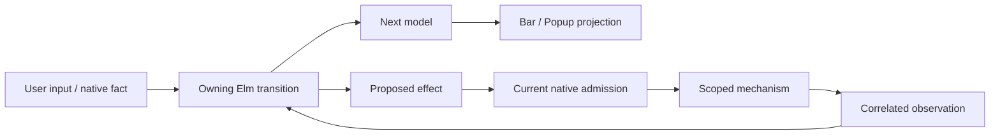

# Why ownership and lifetimes shape Warlock

Warlock combines Elm state transitions, projection-only surfaces and asynchronous native services. The architecture goal is one authoritative policy per responsibility, with explicit boundaries for mechanism and observed facts. It is not a claim that one Elm process owns every resource or that all current code already satisfies every invariant.

A renderer displays a validated snapshot and reports input. It must not invent a second activation/window policy. A native adapter validates current authority, executes a scoped mechanism and returns facts; it must not decide a competing desktop policy. Ports and typed messages expose that seam, but do not themselves provide exactly-once delivery, ordering or lifetime validity.

## Identity is more than a window number

Binding, request, generation, incarnation and output identify who may act and which observation belongs to which state. Publication and popup lease scope presentation/input; grants and custody scope resources. A well-typed Elm value can be stale by the time a native action is admitted. Keep the actual owner and lifetime checks at their existing authoritative boundary.

Pending means an admitted attempt is unresolved. Unknown is not permission to repeat it. Read-only recovery queries the correlated original outcome; frontend or host restart does not silently replay a window effect. `Cmd.batch` does not promise result ordering: dependent work waits for its protocol's actual prerequisite observation, which may involve state or retirement rather than a receipt alone.

## Coherent data is not an atomic native transaction

A snapshot should avoid combining fresh title/control identity with an unrelated lease. Yet one decoded packet does not make ledger mutation, popup opening, queueing, backend execution and teardown one transaction. Each can fail. Likewise Elm garbage collection is not proof that a native frame, callback, mapping or GPU buffer retired.

Loading, authorized historical, current live and unavailable previews are different visible and accessible states. A minimized historical frame may remain authorized without recurring acquisition; revocation still requires retirement. Never confuse power quiescence with authorization or identity-correct icon/title fallback with live preview delivery. The Windows-like taskbar/group/pin behavior remains a requirement; GNOME/KDE offer architectural lessons rather than a replacement UX.

## Why the first extraction is small

The first migration extracts an opaque pure `SurfaceSnapshot` value/codec and leaves rendering dependent on it. `OutputController` and `Presentation` now use that contract directly, preserving the previous renderer API through forwarding functions. Actual Main/Bar/Popup builds, bounded codec properties and production group/retirement replays pass; see the [evidence](../../../implementation/warlock/qa/evidence/pure-surface-snapshot-20261029/manifest.json). This removes a direct policy-to-HTML dependency without changing the intended wire protocol or native authority. It does not establish new native acceptance. The following `AnnouncementMessage` migration removes the remaining `OutcomeAnnouncements` → `Announcement` HTML dependency. Current lexical traversal finds no Html/Browser imports reachable from OutputController; Main still uses Browser/Html. The [message extraction evidence](../../../implementation/warlock/qa/evidence/pure-announcement-message-20261029/manifest.json) preserves a byte-identical pre-existing notification-replay failure, rather than claiming every announcement policy is verified.

Preserve existing same-lease local edits and pending-query behavior rather than introducing a blanket stricter rule during extraction. Normalized valid codec idempotence is not equality with every raw encoding; duplicate-key checks belong before a parsed value discards that distinction. [Contracts and fuzzing](../../warlock-build-loop/v2/FUZZING-CONTRACTS.md) make these invariants explicit and exercise the production route; types and sampled properties do not replace native acceptance.

## Research and retrofit

Current Elm 0.19 TEA uses model/message/update, commands, subscriptions and ports. Historical Signal-era FRP papers examine responsiveness, ordering, demand and temporal lifetime questions under their own semantics. Do not introduce removed APIs or infer native correctness from those papers. The [reviewed research](../../warlock-build-loop/v2/ELM-ARCHITECTURE-RESEARCH.md) and [architecture track](../../warlock-build-loop/v2/ARCHITECTURE-REVIEW.md) inform staged decisions with exact source and tradeoffs.

Existing debt needs the same discipline as new work: identify the actual coupling/contract, select one reversible change, preserve frozen evidence and drafts, verify relevant roots and real properties, then assess native gates. A renamed folder, larger research packet or successful diagnostic build is not a delivered architecture improvement. The active goal remains usable native behavior and the complete original scope.

## A receipt belongs to its request, not the current output

An output may disappear while an admitted window request is still pending. Warlock can then reconcile a surviving output before the original request's outcome arrives. The current scene and the request's historical identity serve different purposes: a scene authorizes fresh actions; a fully correlated outcome settles the original request.

The [receipt lifecycle regression](../../../implementation/warlock/qa/evidence/receipt-output-lifecycle-20261030/LIMITS.md) reproduces a defect in the earlier reducer: it accepted an exact late `Committed` outcome and removed its unresolved reservation while leaving the same transaction `Unknown`. The correction applies the existing full intent/protocol match to transaction settlement regardless of the currently observed output. It does not apply an old scene, issue another effect, settle a newer transaction, or weaken the native binding and issued-request checks.

A disconnect still means `Unknown` until a correlated outcome or validated recovery supplies evidence. Receiving an exact terminal outcome after that point is different from guessing completion or replaying the action. The bounded model and production replay cover these distinctions; actual native delivery and the complete proof-based recovery/release journey remain separate observations.

## A cancellation outcome needs an owning native decision

The current window-effect producer and its decoders use Committed, Refused and Unknown consistently. An internal Elm `Cancelled` value or local menu withdrawal does not establish a native no-mutation certificate. ARC012 requires cancellation and commit to be ordered by the authority at the same serialized boundary; ARC013 separately preserves the original absolute deadline. Adding a decoder case cannot supply either native ownership or physical Escape input.

The private first-Restore proposal separates native Prepared/execution state from frontend observation. Losing a Prepare acknowledgement can make the frontend Unknown while native state remains Prepared; an exact authoritative cancellation could then resolve it. After native execution becomes uncertain or committed, a transport failure cannot establish cancellation or rollback. The boundary must precede the earliest navigation, switcher consumption or focus change, not only the final window-state call. A compensated refusal is also different from zero earlier mutation.

The [first native implementation](../../../implementation/warlock/qa/evidence/native-restore-cancellation-20261030/LIMITS.md) now has a compiled owner/parser and real executor integration. The bounded model's earlier 24 tests and seven sampled campaigns remain separate from the C++ formatting-failure/capacity/parser checks and actual owning-ABI compile. No native load or original cancellation acceptance follows. A source change requires a new native composition; old accepted tuples remain historical. Adapter/durable certificates, scoped input after popup closure, actual native interleavings/resources and broader operation support remain required. See the [staged protocol](../reference/cancellation-protocol.md) and [current status](../reference/status-and-evidence.md).
