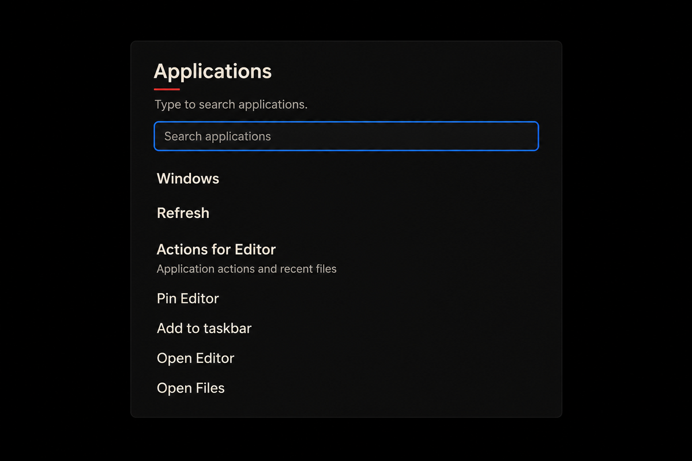
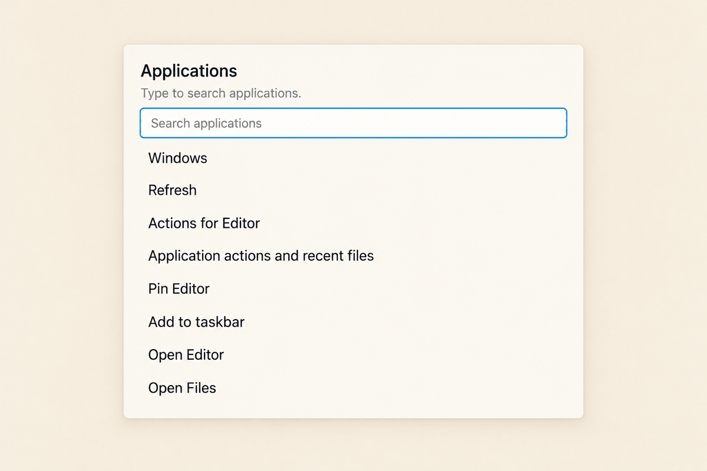

# Applications

## Overview

Applications puts search first and presents a continuous list of explicit actions. The field is 44px minimum at the base text scale. Results use a raised neutral fill and stronger type. Quiet management actions retain their full labels and details. No icon, application card, overflow menu, or automatic launch is required.

## Anatomy and layout

The real renderer emits `.surface-popup[data-mode="applications"]`, a heading, a static status paragraph and `.surface-controls[role="group"]`. Its flat children appear in this order: `.launcher-search[data-surface-field="control:search"]`, `control:close` (Windows), `control:refresh`, optional `control:acknowledge`, optional `jump:open:`, optional `pin:`, each pinned item's `unpin:`, `pin-left:` and `pin-right:`, then `entry:` results. Attributes here refer to `data-surface-control`. Pin applies only to the first matching unpinned entry. Jump actions apply to the first match. Do not group, hide or visually reorder these nodes.

The heading uses window-title; status uses body and secondary text. A 6px scroll gutter protects focus; adjacent rows have a 6px gap. A 16px separation follows the field and precedes the first result where management precedes it. Results use 36px minimum rows; two-line actions expand for their content. The popup fills host allocation, with 560px a documentation preference only. Long names and details wrap without clipping. At short heights the whole popup scrolls; no sticky heading covers a focused row.

## States

The field uses the shared essential boundary, placeholder colour and blue outer focus ring with opaque gap. Enabled controls have neutral hover and pressed fills; disabled controls remain opaque with secondary text and disabled semantics. A slashed unavailable cue requires a renderer-provided accessible cue; CSS does not fabricate one. Applications has no selected-result projection: keyboard focus does not imply selection. The status paragraph stays neutral because the renderer exposes no typed outcome hook. Pending reads “Opening application…”. Submitted reads “Launch submitted.” without a completion check. Refused and Unknown use the exact renderer wording. Unknown exposes “I checked; allow another launch”; Refresh reads current facts and never repeats a launch. The acknowledgement is the neutral outlined secondary action: an essential boundary on the surface fill, distinct from the borderless quiet utilities, in its source position after Refresh. Launch results keep their raised neutral fill; neither carries brand red.

## Behaviour and keyboard

Opening and closing are immediate. Pointer fill changes follow shared 60/90ms motion; focus and geometry change instantly. There is no launcher portal. Search and IME composition only update query state. Activation of an enabled `entry:` control is the explicit launch intent. Elm and its adapter own query composition, identity, focus, request and receipt authority. Search case-folds Unicode and ranks exact name, name prefix, then token prefixes, with identity as tie-breaker. Results retain Elm order. Pending and Unknown disable launch choices; acknowledgement permits another explicit choice. Submitted is not an observed window. The separate application portal starts only on an admitted observation of a newly mapped window.

Keyboard Tab follows the source sequence and Enter or Space activates the focused button. Search receives focus on opening when admitted; browser search clear remains available. Escape and return focus follow the existing popup host policy. The search input retains its accessible name, input type, composition events, publication and lease. The visible associated label precedes the keyed search input and names it through its existing ID. The supplied renderer patch implements this projection. Placeholder text is not a substitute. The requested status icons also require typed outcome data and real semantic nodes. Neither is inferred from strings.

## Accessibility

Use the shared focus recipe, 6px scroll padding and margin, forced colours, high contrast and reduced-motion rules. Opaque surfaces retain their material under reduced transparency. At 200% text, with text-spacing overrides and at 320px effective width, controls grow and wrap. Coarse pointers have 44px minimum button targets. Announcements remain owned by the existing host; the static paragraph is `aria-live="off"`.

## Evidence and integration

Source: `Surface.elm`, `SurfaceRenderer.elm`, `Desktop.elm`, `Popup.elm`, `Catalog.elm`, `SearchFold.elm`, `Launch.elm`, `Pins.elm` and `shell.css`, commit bc3daf7b80ac7295a1ba1e56639a0e130e520a3c. Dense-picker and popup-remap captures show a focused search and flat controls, but equal outlined rows compete with results, and the old tight typography and truncation weaken hierarchy. The v6 Applications specimen is a list projection, not a separate renderer. Material search supports visible query and list results; GNOME search and Windows keyboard guidance inform search and keyboard access; Fluent accessibility and WCAG focus-not-obscured inform focus visibility. The captured KDE layout page is a 404 and provides no guidance. Apple HIG capture provides general design context. The shared foundation overrides incompatible materials and motion.

Integration loads legacy CSS in its layer, D01 tokens/base/focus, then this stylesheet. The area stylesheet switches to whole-surface scrolling at viewport heights of 360px and below. The shared foundation supplies focus rings and appearance tokens. D01 supplies disabled unavailable cues and typed outcome hooks. This area never introduces a second policy store.

## Renderer requirements

The renderer emits a visible `label.launcher-search-label` immediately before the search field as a separately keyed sibling, associated through `for`. The input keeps its key, ID, accessible name and composition handlers. The repository renderer and the compiled test drive both emit the label. Typed outcome and unavailable cues require semantic renderer nodes; CSS does not derive them from prose. The [launcher test-drive scenario](../../test-drive/index.html?scenario=launcher) opens Applications. The [scenario data](scenario.json) records the source-backed workflow. The static Submitted projection documents wording only, since the source closes Applications after submission.

## Concept studies

Generated concept study

Generated concept study

The studies are illustrations. The specimen and renderer patch define the label, button grouping and source order.
