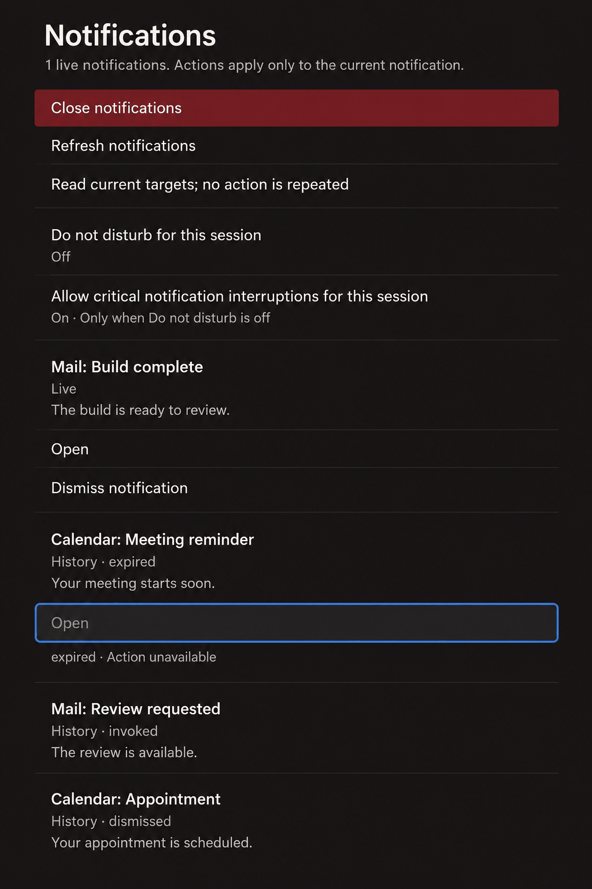
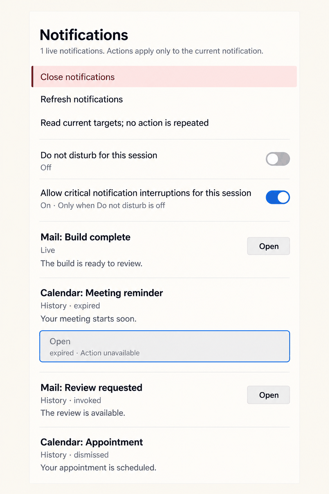

# Notifications and announcements

## Overview

Notifications presents current notifications and their history in one immediately available, opaque surface. Producer and summary form a strong first line; lifecycle detail, body and available actions follow in source order. Actions remain local to their notification and do not imply that historical targets still accept commands.

## Anatomy

The renderer emits `.surface-popup[data-mode="notifications"]`, a heading, a `p[role="status"][aria-live="off"]` and one `.surface-controls[role="group"]`. The controls begin with Close, Refresh, Do not disturb and critical interruption. Each entry is a flat sequence: `p.notification-text[data-notification-content$=":summary"]`, optional `p.notification-text[data-notification-content$=":body"]`, then zero or more `button[data-surface-control^="notification:"]`. The summary label is the producer application and summary joined by a colon; its detail is `Live` or `History ·` followed by the source lifecycle. The body is optional. There is no entry container and no assumed final action selector.

Entries begin with 16px of separation at the summary. Text and actions share an alignment inset. Summary uses 14/20 semibold, body 14/20 regular, and lifecycle detail 12/16 secondary, separated from its label by 2px. Actions have a 36px minimum target and 6px minimum sibling gap. Continuous history has no card borders. The popup uses the shared 16px alignment edge and 6px focus gutter; its renderer fills the host allocation, with a preferred documentation width of 480px. Long text wraps without clamping; the controls scroll with focus paint visible.

## States and behaviour

Live entries expose only their current producer-provided actions and Dismiss notification. Expired, invoked, dismissed, closed, disconnected, unknown and unavailable entries retain their factual history. A focused action whose target expires remains in the keyed projection with `data-focus-only="true"`, `aria-disabled="true"` and unavailable wording; it remains keyboard focusable and cannot activate. Disabled styling retains opacity 1. Refresh reads current targets and never repeats an action. During a read it says `Reading current targets…`; a service failure gives its source reason and the adapter announcement directs the user to refresh. An unknown action result says it is not confirmed and will not be repeated.

`notifications:dnd` and `notifications:critical-interrupt` are independent buttons with their actual `aria-pressed` values. Do not disturb preserves history and suppresses notification speech. Critical interruption is consent for critical arrivals only when Do not disturb is off. Their state wording is visible; CSS does not change the semantics or infer state from copy. Refresh and Close remain quiet controls. Producer actions and Dismiss notification are neutral secondary actions: the essential boundary on the surface fill, distinct from the quiet session controls. An expired focused action keeps that boundary on the recessed fill with secondary text and the shared unavailable cue, so it stays visibly unavailable. Neither a clear-all operation nor categories, timestamps or toast presentation is introduced.

Open and close are immediate. Incoming entries, changing status and action availability never animate, flash or invoke a portal. Pointer hover changes only the enabled fill; keyboard focus uses the shared opaque gap and 2px blue outline, including focus-only unavailable actions. The existing controller maintains publication, lease, focus and action authority. No styling makes a held press act on a replacement target.

## Keyboard and accessibility

Tab and Shift+Tab traverse rendered controls; Enter or Space activates an enabled button. Escape and Close follow the host's existing dismissal and focus-return policy. Scroll padding and scroll margin retain 6px of focus paint. At 200% text and 320px effective width, labels, details and actions wrap and remain reachable. Forced colours use shared system-colour focus and boundaries. Reduced motion, reduced transparency, high contrast and effects-off preserve content and sharp focus. Status paragraphs stay `aria-live="off"`.

`OutcomeAnnouncements` owns admission and correlation; `Announcement.view` renders the single elected live owner with polite or consent-gated assertive delivery. No second live region is added by this component or its static specimen. Focus changes and rerenders do not generate new announcements. Multiple arrivals are summarized by the existing owner rather than spoken separately.

## Shared outcome guidance for D01

Use only typed protocol outcomes. Pending uses neutral waiting wording and a static clock when a typed presentation hook supplies it. Submitted states that the action was sent, not completed. Refused uses a neutral surface, danger octagon and explicit reason when typed as refused. Unknown uses a warning question diamond and unconfirmed wording; Refresh only reads. Positive checks require confirmed completion. Untyped notification service reasons remain neutral and are never classified from text. These glyphs require typed renderer projections; this CSS does not create them or duplicate announcements.

## Evidence and renderer requirements

Source authority is commit `bc3daf7b80ac7295a1ba1e56639a0e130e520a3c`, especially `Surface.elm`, `SurfaceRenderer.elm`, `Notifications.elm`, `Desktop.elm`, `OutcomeAnnouncements.elm`, `Announcement.elm` and `AdapterNotice.elm`. The native history captures show low hierarchy between summary, body and lifecycle and large outlined actions. The new spacing and weight separate them without inventing a wrapper. The window-feedback capture establishes unconfirmed language and read-only refresh.

Material list and button captures inform grouping and target sizing; GNOME notification guidance informs concise action placement; Fluent and Windows notification captures inform actionable message hierarchy; KDE layout and Apple HIG captures inform alignment and restraint; WCAG focus captures inform unobscured focus. Warlock's opaque material and exact tokens govern where platform patterns differ.

The shared foundation supplies fonts, control states, focus ring and scrollport layout. D01 integrates the area stylesheet after those rules. The selected policy control uses its existing On wording as the non-colour cue, with a 3px leading bar and selected fill. Disabled and focus-only controls retain their full focus treatment. A typed outcome glyph requires an explicit renderer projection before implementation. The existing summary combines producer and summary into one text node, so CSS does not style them independently. Accurate relationships survive arbitrary action counts through the next summary's leading separation. No CSS selector depends on dynamic identity values, a last action, text parsing or a fabricated wrapper.

## Expiry sequence and specimen

[Open Notifications in the desktop](../../test-drive/index.html?scenario=notifications). The [scenario fixture](scenario.json) specifies the live-to-expired sequence at a stable service and incarnation. The renderer keeps the keyed control when its target expires and gives it `data-focus-only="true"` and `aria-disabled="true"`; its message is absent. The controller retains authority over activation. A real host test records focus before and after the observation, attempts Enter and Space, and checks both the emitted effects and the elected announcement owner. The [expiry exercise](expiry.html) supplies the live and expired service observations to the compiled controller and renderer. The static gallery represents the final state only.

The bounded Night runtime fixture uses a 420px host and a dedicated controls scrollport. The Dawn comparison shows the same live and historical content at its natural height. Content-sized comparisons show empty history, unavailable service with refresh pending, unknown and refused results. The examples include reduced motion, effects off and high contrast. The text scale control changes the document root once, including rem-based text and targets. Long text and multiple live actions exercise wrapping and source order.

## Generated concept studies

Generated concept study. The Night image is illustrative; Close and the unavailable action detail differ from the renderer.

Generated concept study. The Dawn image is illustrative; its switch shapes and historical action do not represent the renderer.
